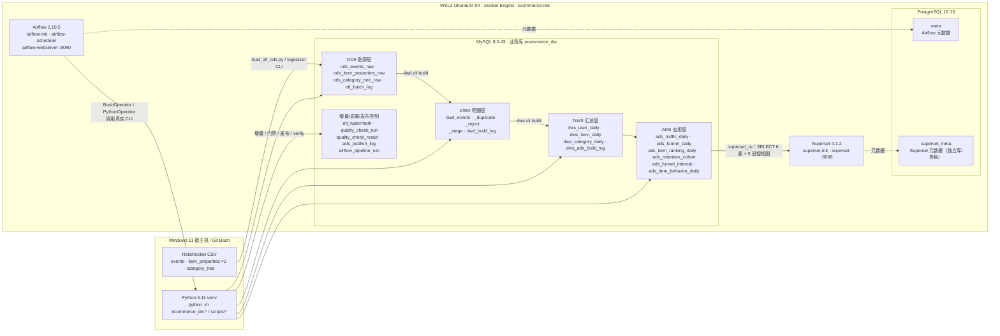

# ecommerce-data-platform

**基于 Retailrocket 电商行为数据的四层数据仓库与看板平台（V1.0）**：把约 1 GB 原始 CSV 建设为 MySQL 四层数仓（ODS → DWD → DWS → ADS），由 Airflow 每日编排增量构建与 60 条硬质量门禁，Superset 提供三个只读业务看板。

**阶段状态：Phase 1–8 全部完成，V1.0 已交付；Phase 9.1–9.4 已完成。** Phase 9 为可选的 Kafka + Flink 实时扩展：已完成 Kafka/Flink 基础设施、`event_v1` 消息契约、DWD 回放器、schema 校验/DLQ 消费者、`ecommerce_rt` 5 张结果表与最小权限账号，以及 Flink DataStream 实时作业（`event_id` 去重 → UTC 日窗口 → JDBC upsert）。9.4 分 20 批回放覆盖 137 个完整日（DWD 2,755,641 条，含前瞻重复共发 3,599,961 条），13 指标 × 137 天与离线 ADS 及独立 DWD SQL 全部 MATCH，并完成吞吐/延迟/反压容量验收。

---

## 1. 一句话定位

一个可复现、可审计、可运维的**单机批处理数仓样板**：原始事件不丢一行（ODS 字符串保真）→ 明细标准化并精确去重（DWD 恒等式）→ 用户/商品/类目日汇总（DWS）→ 可直接出报表的指标表（ADS）→ 水位线增量 + 60 条硬门禁 + 发布审计 → Airflow 十任务日调度 → Superset 只读看板。

## 2. 架构



**组件与端口**（宿主机映射，均可在 `.env` 调整）：

| 服务 | 容器/镜像 | 宿主机端口 | 用途 |
| --- | --- | ---: | --- |
| MySQL | `ecommerce-mysql` / `mysql:8.0.43` | 3306 | 业务数仓 `ecommerce_dw`（四层 + 控制表） |
| PostgreSQL | `ecommerce-postgres` / `postgres:16.13` | 5432 | Airflow 元库 `meta` + Superset 元库 `superset_meta` |
| Airflow Web | `ecommerce-airflow-webserver` | 8080 | DAG 触发、日志、回填 |
| Superset Web | `ecommerce-superset` | 8088 | 三个只读看板 |
| Airflow init | `ecommerce-airflow-init` | — | 一次性迁移元库 + 幂等建 admin |
| Superset init | `ecommerce-superset-init` | — | 一次性建 `superset_meta` + 迁移 + 导入看板 + 修正连接口令 |

> 业务库与元数据库**引擎、实例、凭据三隔离**；Superset 不直连 `ecom_app`，只用只读账号 `superset_ro`（6 张 ADS 表 + 5 个受控视图，详见 `docs/superset_design.md`）。

## 3. 数据规模与 V1.0 基线

> 以下为 Phase 8 验收时对生产库 `ecommerce_dw` 的实测值；演示脚本 `scripts/demo_phase8.py` 在运行前后逐表比对这组基线，任何一张表变化即失败。

| 层 | 表 | 行数 |
| --- | --- | ---: |
| ODS | `ods_events_raw` | 2,756,101 |
| ODS | `ods_item_properties_raw` | 20,275,902 |
| ODS | `ods_category_tree_raw` | 1,669 |
| ODS 合计 | 3 张表 | **23,033,672** |
| DWD | `dwd_events`（去重后标准明细） | 2,755,641 |
| DWD | `dwd_events_duplicate` | 460 |
| DWD | `dwd_events_reject` | 0 |
| DWS | `dws_user_daily` | 1,649,534 |
| DWS | `dws_item_daily` | 1,672,186 |
| DWS | `dws_category_daily` | 94,194 |
| ADS | `ads_traffic_daily` | 139 |
| ADS | `ads_funnel_daily` | 1,251（139 日 × 9 指标） |
| ADS | `ads_item_ranking_daily` | 13,900（139 日 × Top-100） |
| ADS | `ads_retention_cohort` | 278（139 cohort × 2 年龄日） |
| ADS | `ads_funnel_interval`（R16 物化） | 1 |
| ADS | `ads_item_behavior_daily`（R16 物化） | 139 |
| 控制 | `etl_watermark` | 139 |
| 控制 | `ads_publish_log` | 12（只增不删） |

**恒等式**：`2,756,101 = 2,755,641 + 460 + 0`（`python -m ecommerce_dw.dwd.cli verify` → `identity=OK`）。
**DWD 事件分布**：`view` 2,664,218 / `add_to_cart` 68,966 / `transaction` 22,457。
**DWS/ADS 全量构建**：9 张输出表累计 **3,431,622 行**，build #8（FULL，LOADED，555.7s）。
**独立复核**：`python -m ecommerce_dw.cli verify` → **2,094 checks，ALL MATCH**。

### 3.1 核心指标（最终口径，完整窗口）

完整窗口 = `[2015-05-04, 2015-09-17]`（137 个完整自然日）；全部数据窗口 = 139 个 UTC 日（含 2015-05-03、2015-09-18 两个部分日，`is_full_day=0`）。

| 指标 | 完整窗口 | 全 139 日（含部分日） |
| --- | ---: | ---: |
| PV（`view` 行数，不去重） | 2,649,436 | 2,664,218 |
| UV（`view` 去重访客，区间口径） | 1,396,937 | 1,404,178 |
| DAU（日指标，区间去重参考） | 1,400,324 | — |
| 加购用户数 | 37,515 | 37,722 |
| 交易用户数 | 11,667 | 11,719 |
| 订单数（`distinct transaction_id`） | 17,591 | 17,672 |
| 加购率（口径 A） | 2.69% | — |
| 严格转化率（交易 ∩ 浏览 / 浏览） | 0.80% | — |
| 全局转化率（全部交易 / 浏览） | 0.84% | — |
| 次日留存 D1（完整 cohort 加权） | 2.75% | — |

> 口径签名、逐日/区间差异、部分日处置见 `docs/metric_definitions.md`；行级来源见 `docs/dws_ads_design.md` §8。
> 表中“全 139 日”列的用户数/订单数为 Phase 1 ODS 原始口径（用于窗口对比）；“完整窗口”列为 ADS 构建后的最终值。

## 4. 目录结构

```text
ecommerce-data-platform/
├─ airflow/dags/            # ecommerce_daily_pipeline（10 任务链）+ phase6_retry_demo
├─ config/                  # 配置模板（不含凭据）
├─ dashboards/
│  ├─ exports/              # 可重建看板包（charts / dashboards / datasets / databases）
│  └─ screenshots/          # 8 张真实渲染验收截图（R16 硬断言）
├─ data/{raw,staging,sample}/  # 原始 CSV 与中间数据（不入库、不提交）
├─ docker/
│  ├─ airflow/              # Dockerfile + init.sh（db migrate + 幂等 admin）
│  ├─ mysql/init/           # 01_init.sh（幂等建库 + utf8mb4）
│  └─ superset/             # Dockerfile + init.sh + fix_database_password.py
├─ docs/                    # 架构、口径、设计与运维文档
├─ notebooks/01_eda.ipynb   # Phase 1 全量 EDA（已执行）
├─ scripts/                 # DDL 应用、ODS 批量装载、健康检查、演示、Superset 生成/验收
├─ sql/ddl/                 # ODS/DWD/DWS/ADS/控制表 DDL + ads_views/ 受控视图 + streaming/（rt_* 5 表）
├─ src/ecommerce_dw/
│  ├─ eda/                  # 无库流式统计
│  ├─ ingestion/            # ODS 分块幂等装载（断点续跑）
│  ├─ dwd/                  # DWD 标准化 / 精确去重 / 异常隔离
│  ├─ dws/                  # DWS + ADS 纯 SQL 服务端聚合
│  ├─ incremental/          # 水位线、迟到窗口、回填规划
│  ├─ quality/              # 60 条规则、硬门禁、发布作用域守卫
│  ├─ ops/                  # Airflow 控制面（窗口/校验/批次登记）
│  ├─ streaming/            # Phase 9：event_v1 构造/校验、DWD 回放器、DLQ 消费者、RT DDL/授权、批流对账
│  └─ cli.py                # 统一入口 incremental / quality / publish / verify / status
├─ streaming/               # Phase 9：event_v1 JSON Schema 与 Flink DataStream 作业源码
├─ tests/                   # 单元 / 集成 / E2E / DAG 契约
├─ docker-compose.yml       # 生产栈
├─ docker-compose.fresh.yml # 全新环境 overlay（独立容器名/卷）
├─ pyproject.toml
├─ .env.example
└─ README.md
```

## 5. 五分钟快速开始（冒烟路径）

> 前提：Windows 11 + WSL2 Ubuntu24.04（Docker Engine 已就绪），uv 已安装，四个 CSV 已放在 `data/raw/retailrocket/`。本路径**不重载 23M 行**；首次拉取/构建镜像、下载约 1 GB CSV 的时间不计入 5 分钟。完整重建见 §6。

```bash
# 1) Python 环境
uv venv --python 3.11 .venv
source .venv/Scripts/activate          # Git Bash；PowerShell 用 .\.venv\Scripts\Activate.ps1
uv sync --all-extras

# 2) 配置（.env 已被 git 忽略，禁止提交）
cp .env.example .env
# 编辑 .env：至少设置 MYSQL_ROOT_PASSWORD / MYSQL_PASSWORD /
# POSTGRES_PASSWORD / AIRFLOW_FERNET_KEY / AIRFLOW_WEBSERVER_SECRET_KEY /
# SUPERSET_SECRET_KEY / MYSQL_RO_PASSWORD

# 3) 起数据库（先只起 MySQL/PostgreSQL，等健康）
wsl -d Ubuntu24.04 -- bash -lc "cd /mnt/c/Zproject/data-engineering/ecommerce-data-platform && docker compose up -d mysql postgres"
wsl -d Ubuntu24.04 -- bash -lc "cd /mnt/c/Zproject/data-engineering/ecommerce-data-platform && docker compose ps"

# 4) 连通性 + 应用各层 DDL（全部 CREATE IF NOT EXISTS，可重复执行）
python scripts/check_db_health.py
python scripts/apply_ods_ddl.py
python scripts/apply_dwd_ddl.py
python scripts/apply_dws_ads_ddl.py
python scripts/apply_quality_ddl.py
python scripts/apply_perf_indexes.py

# 5) 一键隔离演示：自动建独立 *_test schema、装 14 行样例、
#    跑 incremental → 迟到重算 → 60 条门禁 → publish → verify，
#    并逐表校验生产 13 张表行数不变（约 4.2s；完整栈尚未启动时加 --skip-http）
python scripts/demo_phase8.py --skip-http

# 6) 起完整栈（Airflow + Superset），两个 init 容器退出码 0 即完成
wsl -d Ubuntu24.04 -- bash -lc "cd /mnt/c/Zproject/data-engineering/ecommerce-data-platform && docker compose up -d"

# 7) Superset 只读授权 + 看板生成（幂等）
python scripts/apply_superset_grants.py
python scripts/superset_setup.py
```

访问：Airflow `http://localhost:8080`，Superset `http://localhost:8088`（管理员账号见 `.env`）。

`demo_phase8.py` 常用参数：`--keep` 保留演示 schema；`--skip-http` 跳过 Airflow/Superset `/health` 探测（仅验证数据库链路时用）。

## 6. 完整重建（从 CSV 到看板）

```bash
# 0) 确认四个文件与 SHA-256（见 docs/dataset.md §3）
ls -lh data/raw/retailrocket/

# 1) ODS 全量装载（幂等；SHA-256 已 LOADED 的文件自动 skip；断点续跑）
python scripts/load_all_ods.py
# 实测：events 2,756,101；item_properties part1/part2 合计 20,275,902；category_tree 1,669

# 2) DWD 全量构建（build #30 基线：2,755,641 + 460 + 0）
python -m ecommerce_dw.dwd.cli build
python -m ecommerce_dw.dwd.cli verify

# 3) DWS/ADS 全量构建（build #8：3,431,622 行 / 9 表 / 555.7s）
python -m ecommerce_dw.dws.cli build
python -m ecommerce_dw.cli verify

# 4) 水位引导（把已建成的存量仓库登记为 137 个业务日期）
python -m ecommerce_dw.cli incremental --init --to 2015-09-16

# 5) 全量质量门禁 + 发布（publish 必须引用 PASS run；下面用最新 run id）
python -m ecommerce_dw.cli quality run
python -m ecommerce_dw.cli publish --run <PASS_RUN_ID>

# 6) 状态与历史
python -m ecommerce_dw.cli status
python -m ecommerce_dw.cli quality show --run <PASS_RUN_ID>
```

> 完整装载耗时以 `docs/ods_design.md` §6.5 与 `docs/performance.md` 为准；本机实测 events 约 38 分钟、part1 约 42 分钟、part2 约 76 分钟（含 WSL2 重启等待），不要把它当作 5 分钟演示。

## 7. 三条业务链路

### 7.1 增量 → 质量门禁 → 发布（Phase 5）

```bash
python -m ecommerce_dw.cli incremental                 # 水位线驱动：新尾巴 + 7 天窗口内迟到
python -m ecommerce_dw.cli incremental --dry-run       # 只规划不执行
python -m ecommerce_dw.cli incremental --from 2015-09-16 --to 2015-09-16  # 历史深修正
python -m ecommerce_dw.cli quality run                 # 60 条硬规则，任一 FAIL 即 exit 非 0
python -m ecommerce_dw.cli publish --run <PASS_RUN_ID> # 门禁 PASS + 作用域匹配才写 ads_publish_log
```

- 水位线 `etl_watermark` 以「业务日期 × 已消费 ODS 批次」为唯一驱动；成功才前推。
- 稳定态重跑 = `built=(none) ... duration=0.00s` 的合法 no-op。
- 门禁 60 条：完整性 3 + 唯一性 12 + 合法性 9 + 范围 12 + 跨层对账 24。
- 发布作用域守卫：FULL 发布须由 FULL PASS 门禁背书；DATES 发布须由**同日期集合**的 DATES PASS 门禁背书，否则拒绝并 exit 2。
- 最新复验：run #7 **PASS 60/60，89,305,119 行，209.50s**（Phase 8；Phase 5 设计文档 §9.4 记录的 run #3 同为 60/60 / 89,305,119 行，耗时 224.65s，差异来自索引优化后的重跑）。

### 7.2 Airflow 日调度（Phase 6）

DAG `ecommerce_daily_pipeline`，LocalExecutor，元库 PostgreSQL `meta`：

```text
start → check_source_files → register_batch → load_ods → validate_ods
      → build_dwd → build_dws → build_ads → quality_gate → publish_success
```

`schedule="0 4 * * *"`、`catchup=False`、`max_active_runs=1`。业务日期由逻辑日期/水位线驱动；显式回填：

```bash
docker compose exec airflow-scheduler airflow dags trigger ecommerce_daily_pipeline \
  --conf '{"from": "2015-09-16", "to": "2015-09-17"}'
```

每次运行在 `airflow_pipeline_run` 留一行（窗口、规划日期、门禁号、发布号、状态、错误摘要）。详见 `docs/airflow_design.md`。

### 7.3 Superset 看板（Phase 7）

- 三个看板 21 张图：运营总览 11 / 用户行为 5 / 商品分析 5。
- 只读账号 `superset_ro`：6 张 ADS 表 + 5 个受控视图，**无任何写权限**；不开放 `ads_publish_log` 控制表。
- 昂贵图源已物化：`ads_funnel_interval`（1 行）、`ads_item_behavior_daily`（139 行），冷启动从 ~9.3s / ~10.0s 降到 ~0.00s。
- 8 张真实渲染截图在 `dashboards/screenshots/`，截图脚本带硬断言（任何 `Waiting on` / `No results` → exit 1）。
- 刷新链路：`publish` 追加 `ads_publish_log` → `v_ads_publish_status` 计数 +1 → 商品分析看板“累计发布次数” KPI +1。

### 7.4 Web UI（Phase 11，只读 + 本地分析沙箱）

面向 ADS 报表 / 实时结果 / 质量与运维的一体化只读界面：FastAPI 提供 `/api/*`，
同一容器托管 React SPA；业务连接固定使用只读账号 `webapp_ro`（仅 SELECT）。

`/analyze` 另提供上传分析：CSV / Excel 经字段识别与人工确认后，由单 worker 在
`ANALYSIS_DATA_DIR` 下的独立 DuckDB 中解析、规范化并聚合；原始文件、`normalized.csv`、
`analysis.duckdb`、`result.json` 只写任务目录并按 TTL 清理，**不写 MySQL**。`/model`
页解释四层批处理数仓与上传沙箱的关系。

上传区与英雄区分离，「开始分析 → 结果」使用案卷展开式转场（View Transitions 做路由
交叉淡入，`prefers-reduced-motion` 时退化为短淡出）。批流对账页 `/realtime` 仍保留
接口和页面，但当前**没有接入新的实时数据源**，侧栏入口暂时收起，只作为内部验证视图
从 `/model` 进入。

```bash
# 1) 幂等创建/同步只读账号（读 .env 的 WEB_DB_USER / WEB_DB_PASSWORD）
python scripts/create_webapp_ro.py

# 2) 构建并启动（仅新增 web 容器，不影响现有服务）
wsl -d Ubuntu24.04 -- bash -lc "cd /mnt/c/Zproject/data-engineering/ecommerce-data-platform && docker compose up -d web"
```

访问 **http://localhost:8090**（端口由 `.env` 的 `WEB_UI_PORT` 控制）。
宿主机直接调试：`cd web/backend && ../../.venv/Scripts/python.exe -m uvicorn app.main:app --port 8090`。
架构、接口契约、权限模型与排障见 `docs/webapp_design.md`。

## 8. 测试与质量证据

| 项 | 命令 | 结果 |
| --- | --- | --- |
| 宿主全量测试 | `python -m pytest` | **314 passed, 1 skipped**（skip = 宿主无 Airflow 时整模块跳过 DAG 测试） |
| DAG 契约测试 | `docker compose exec -T airflow-scheduler python -m pytest tests/dag` | **5 passed** |
| 代码规范 | `ruff check . && ruff format --check .` | 全绿 |
| 一键端到端演示 | `python scripts/demo_phase8.py` | 8 步通过，约 **4.2s**，生产 13 张表行数不变 |
| 质量门禁 | `python -m ecommerce_dw.cli quality run` | run #7 **PASS 60/60，89,305,119 行，209.50s** |
| ADS 独立复核 | `python -m ecommerce_dw.cli verify` | **2,094 checks，ALL MATCH** |
| Superset 指标一致性 | `python scripts/superset_evidence.py` | 5 项关键指标 **ALL MATCH** |
| Superset UI 验收 | `python scripts/superset_ui_evidence.py` | 8 张截图，硬断言通过 |
| 全新环境 | `docker-compose.fresh.yml` + 独立 env | 独立项目/端口/卷起栈、3 看板 15 数据集、只读 smoke 查询通过 |
| Phase 9.2 实时回放 | `scripts/replay_to_kafka.py --from 2015-07-14 --rate 5000` | 两轮各 **26,868** 条，0 schema 错误，约 **4,985 msg/s** |
| Phase 9.2 消费校验/DLQ | `scripts/consume_validate.py --from-beginning` | 第 2 轮 53,736 条全合法、0 非法、distinct `event_id` 26,868；DLQ 演练仅测试 topic |
| Phase 9.3/9.4 Java 自检 | `bash scripts/build_flink_job.sh` | **59 passed / 0 failed**（9.4 新增 4 项 `ingest_time` + 2 项 `transaction_id=0` 契约 + 11 项 `is_final` 单调性），jar 38,106 bytes |
| Phase 9.3 实时回放 | `scripts/replay_to_kafka.py --from 2015-07-15 --to 2015-07-17 --rate 2000` | **65,940** 条，0 失败，32.98 s，**1,999.2 msg/s** |
| Phase 9.3 批流对账 | `python scripts/verify_rt_vs_dwd.py 2015-07-14 2015-07-16`（只读 `rt_recon_ro`） | **39/39 MATCH**（3 天 × 13 指标），`VERIFY_RT_VS_DWD_OK` |
| Phase 9.3 恢复演练 | `flink cancel` → `flink run -d -s <chk-1>` | `restored:1`，续读位点非 0，恢复后对账仍 39/39 MATCH |
| Phase 9.4 全量回放 | `python scripts/run_full_reconciliation.py --evidence-dir <dir> --reset-rt --reconcile` | 20 批覆盖 137 完整日；DWD **2,755,641** 条事件，含前瞻日重复回放共发出 **3,599,961** 条，checkpoint 122 成功 / 0 失败 |
| Phase 9.4 全量对账 | `python scripts/reconcile_all.py --write`（只读 `rt_recon_ro` + `rt_app` 写审计表） | **1,781 MATCH / 0 DIFF / 26 SKIP**，审计表 1,807 行，`RECONCILIATION_OK` |
| Phase 9.4 容量验收 | `--rate 5000` 与单批 `--rate 10000`；采样 REST 指标 | 生产者 4,991–9,755 msg/s；端到端延迟活跃期 p50 中位 478 ms / p95 中位 549 ms（含 0 值口径 p95 中位 115 ms，偏乐观；回放进行中去重后 p95 中位 170 ms），最大观测 671 ms；反压 0；state 最大 41 MB |

测试矩阵与手算基线见 `docs/test_matrix.md`；性能优化与 EXPLAIN 见 `docs/performance.md`。

## 9. 已知限制

- **离线批处理仍是主链路，实时链路用于回放验证**：Phase 9.1–9.4 已落地 Kafka/Flink session 集群、回放器、schema 校验/DLQ、`ecommerce_rt` 结果表与 Flink 日窗口作业；9.4 已把 137 个完整日全部回放并与离线 ADS 同口径 1,781/1,781 MATCH，但未接入在线流量，商品排行/留存/告警未实时化。
- **数据是 2015 年历史快照**：Retailrocket 数据集静态、无持续新增；增量的“新尾巴”在本仓库靠重放/样例模拟，不是真实在线流量。
- **匿名访客口径**：`visitorid` 是 Cookie 级匿名标识，不是注册用户；Cookie 清理会高估 UV/留存。`visitorid=0` 的 3 行作为未知访客桶，计入 PV、不计入去重用户。
- **首末日是部分日**：2015-05-03 自 03:00 UTC 起、2015-09-18 至 02:59 UTC 止；ADS 用 `is_full_day=0` 标记，留存末尾 cohort 用 `window_status='partial'`，不得当完整率使用。
- **单机单实例**：LocalExecutor、单 MySQL、单 PostgreSQL，无 HA/多副本；`max_active_runs=1` 是幂等重建的串行前提。
- **Superset 是本地演示级权限模型**：默认 admin + 只读业务账号，未接 SSO/LDAP；生产化需替换认证与 TLS。
- **全量重载不在 CI**：23M 行装载与全量构建只在本机按需执行；常规测试只跑小样例。
- **WSL2 稳定性**：本机曾出现 VM 重启/内存压力导致后台构建被杀；构建器支持断点续跑与 `--force`，但生产部署应放到稳定的 Linux 主机。
- **历史发布审计**：`ads_publish_log` 的 publish_id 5–9 是 Phase 7 作用域规则上线前的证据发布，保留不删；现行规则下同类 FULL↔DATES 组合会被拒绝。

## 10. 安全说明

- `.env`、`config/config.yaml`、`data/` 均被 `.gitignore` 忽略；**仓库内没有任何真实口令**。
- DAG 源码不持有凭据；Airflow 任务从 compose 注入的 `MYSQL_*` / `POSTGRES_*` 环境变量取连接信息。
- Superset 业务连接使用独立只读账号 `superset_ro`，权限仅 `SELECT` 6 张 ADS 表 + 5 个受控视图；控制表 `ads_publish_log` 不开放，新鲜度通过 `v_ads_publish_status` 视图暴露。
- Phase 9.2 实时账号独立：`rt_app` 仅 `ecommerce_rt.*` 的 SELECT/INSERT/UPDATE/DELETE；`rt_recon_ro` 仅 `ecommerce_rt.*` + `ecommerce_dw.ads_*` 只读；应用账号无 `ecommerce_dw` 任何权限。Phase 9.3 对账固定使用 `rt_recon_ro`，不使用 `rt_app`。
- Airflow 元库 `meta` 与 Superset 元库 `superset_meta` 物理隔离，分别使用不同角色；业务库 `ecommerce_dw` 与元数据库不同引擎、不同实例、不同凭据。
- 本地 `.env` 使用弱口令仅用于开发；生产必须改用密钥管理（Vault/KMS/云 Secrets），并限制 3306/5432/8080/8088 的访问来源。
- 数据集许可 **CC BY-NC-SA 4.0**（非商业、署名、相同方式共享），商用需另行确认授权，见 `docs/dataset.md` §6。

## 11. 文档索引

| 文档 | 内容 |
| --- | --- |
| `docs/architecture.md` | V1.0 架构图、数据流、组件/端口、分层职责、关键决策、Roadmap |
| `docs/deployment.md` | 从零部署：前置条件、`.env` 配置、起栈顺序、初始化、健康检查、fresh overlay、升级/回滚 |
| `docs/operations.md` | 日常调度、手动回填、批次失败清理、门禁 FAIL、publish 拒绝、DAG 重跑、看板刷新、备份恢复、WSL2 问题 |
| `docs/dataset.md` | 数据来源、镜像评估、SHA-256、许可 |
| `docs/data_contract.md` | 事件契约、字段映射、异常策略、血缘 |
| `docs/data_dictionary.md` | 全部 ODS/DWD/DWS/ADS/控制表：列、类型、粒度、唯一键、行数基线、上下游 |
| `docs/metric_definitions.md` | PV/UV/DAU/加购/转化/留存/订单/商品行为的最终口径与实测值 |
| `docs/ods_design.md` | ODS 批次模型、幂等键、断点恢复、实测 |
| `docs/dwd_design.md` | DWD 转换、去重、异常隔离、恒等式、实测 |
| `docs/dws_ads_design.md` | DWS/ADS 表结构、聚合 SQL、幂等重建、`verify`、实测 |
| `docs/incremental_and_quality.md` | 水位线模型、增量规划、60 条规则目录、发布门控、崩溃恢复 |
| `docs/airflow_design.md` | DAG 结构、调度参数、凭据、回填/排查手册、实测 |
| `docs/superset_design.md` | 部署拓扑、只读权限、元库隔离、看板/筛选器、验收证据 |
| `docs/webapp_design.md` | Web UI 架构、API 契约、webapp_ro 权限模型、部署与排障 |
| `docs/performance.md` | Phase 8 性能优化、EXPLAIN、索引决策、全新环境验证 |
| `docs/test_matrix.md` | 测试矩阵、手算样例、DAG 契约测试、已知边界 |

## 12. Phase 9：实时扩展进展（可选）

**9.1 基础设施与契约（已完成）**：Kafka 3.9.1 KRaft 单节点、Flink 1.20.1 session 集群、
`ecommerce.events.v1` / `.dlq` topic、`event_v1` JSON Schema、`ecommerce_rt` 空库；
checkpoint 取消保留与恢复演练通过。

**9.2 回放与校验（已完成）**：只读回放 `dwd_events` 到生产 topic（确定性 `event_id`、
幂等 producer、有界重试与失败 spool）、schema 校验消费者与 DLQ、`ecommerce_rt` 5 张结果表 DDL、
`rt_app` / `rt_recon_ro` 最小权限账号。2026-11-07 对 2015-07-14（26,868 事件）完成两轮回放：
0 schema 错误，重复回放后 distinct `event_id` 保持 26,868；生产 13 表基线验收前后一致。
详见 `docs/streaming_design.md` §11.2。

**9.3 实时作业（已完成）**：Flink DataStream 作业 `ecommerce-rt-daily-metrics`
（`streaming/flink-job/`）：KafkaSource → `event_v1` 解析/校验（非法进 DLQ）→
`event_id` 去重（48h TTL）→ UTC 日滚动窗口（30s 乱序水位线、24h 允许迟到、迟到旁路）
→ `rt_traffic_daily` / `rt_funnel_daily` / `rt_item_behavior_daily` JDBC 幂等 upsert。
2026-11-07 主验收 JobID `c2bc776cd60fab3afd2ca80a5e2c071e`：消费 119,676 条、
去重 26,868 条、7/14–7/16 共 39 个指标与 `dwd_events` 独立 SQL 对账 **全部 MATCH**；
cancel → checkpoint → `flink run -s` 恢复演练 `restored:1` 且续读位点正确。详见
`docs/streaming_design.md` §11.3。

**9.4 全量对账与容量验收（已完成）**：20 批 × （目标 7 天 + 2 前瞻日）覆盖
2015-05-03..2015-09-18 全部 137 个完整日；`rt_traffic_daily` 139 行（138 final）、
`rt_funnel_daily` 973 行、`rt_item_behavior_daily` 139 行；`rt_reconciliation_daily`
**1,807 行（1,781 MATCH / 0 DIFF / 26 SKIP）**，ADS 与 DWD 交叉复核同样 0 差异。
实测生产者 4,991–9,755 msg/s；端到端延迟按活跃期口径 p50 中位 478 ms、p95 中位 549 ms
（回放进行中去重后 p95 中位 170 ms，含 0 值口径 p95 中位 115 ms 偏乐观），
最大观测 671 ms；反压 0、checkpoint 122 成功 / 0 失败、state 最大 41 MB。
详见 `docs/streaming_design.md` §11.4。

常用命令：

```bash
bash scripts/download_flink_jars.sh          # 下载固定版本 connector 驱动
bash scripts/build_flink_job.sh              # javac --release 17 + 59 项自检 + 打 jar
docker compose build flink-jobmanager flink-taskmanager
docker compose up -d --force-recreate flink-jobmanager flink-taskmanager
bash scripts/deploy_flink_job.sh             # 提交作业并打印 JobID
python scripts/verify_rt_vs_dwd.py 2015-07-14 2015-07-16  # 只读账号 rt_recon_ro
```

对账脚本使用 `RT_RECON_RO_USER`（默认 `rt_recon_ro`）/ `RT_RECON_RO_PASSWORD` 连接
`ecommerce_rt`，并在会话内设置 `READ ONLY`；不会使用有 DML 权限的 `rt_app`。
`RT_RECON_RO_PASSWORD` 只放在本地 `.env`。

**未实现（后续可选）**：商品 Top-N 排行、留存 cohort、监控告警、application 模式/自动恢复、
实时看板衔接。V1.0 不依赖本扩展。
