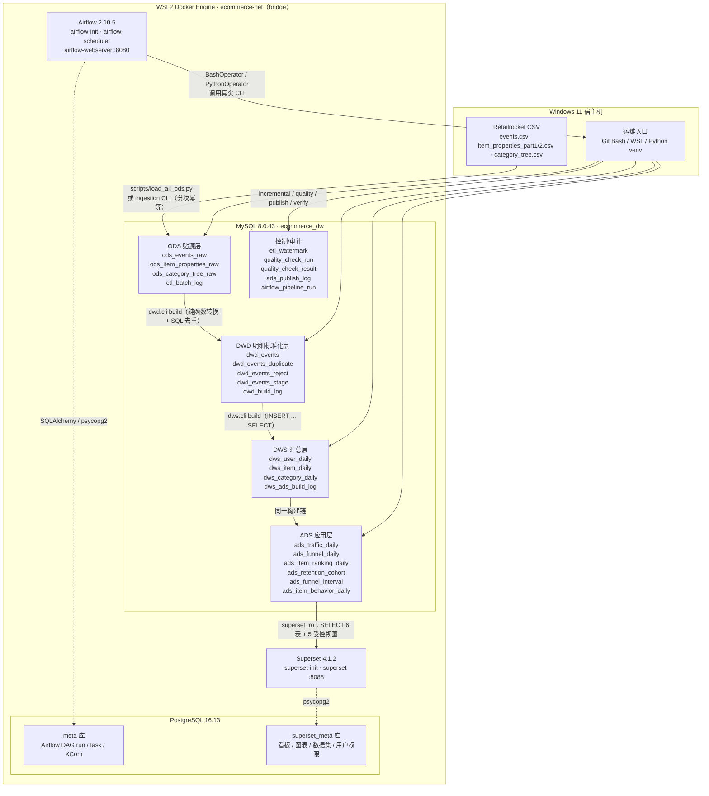
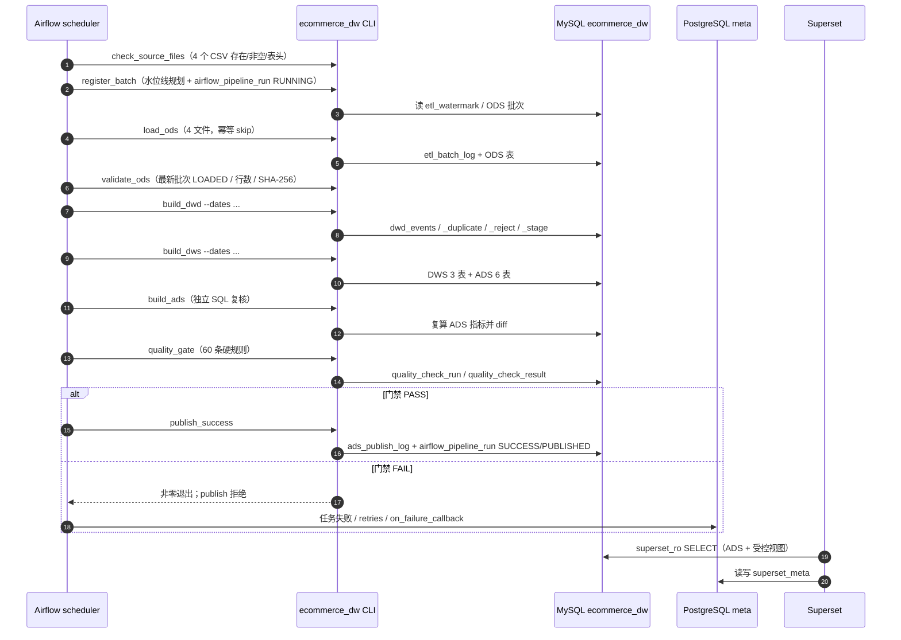

# 架构文档（V1.0）

## 1. 定位与状态

本项目把 Retailrocket 电商用户行为数据（网页浏览 / 加购 / 交易事件）建设为四层数据仓库（ODS / DWD / DWS / ADS），由 Airflow 定时编排，Superset 提供只读看板。

**Phase 1–8 已全部完成并交付 V1.0**：

| 阶段 | 交付 |
| --- | --- |
| Phase 1 | 全量 EDA、字段梳理、指标口径、数据契约 |
| Phase 2 | ODS 贴源入库，23,033,672 行，批次审计 + 断点续跑 |
| Phase 3 | DWD 标准化 / 精确去重 / 异常隔离，恒等式 `ODS = DWD + dup + reject` |
| Phase 4 | DWS 3 表 + ADS 6 表，独立 `verify` 2,094 checks ALL MATCH |
| Phase 5 | 水位线增量 + 60 条硬质量门禁 + 发布审计/作用域守卫 |
| Phase 6 | Airflow `ecommerce_daily_pipeline` 十任务链，LocalExecutor + PostgreSQL meta |
| Phase 7 | Superset 4.1.2 三看板 21 图，独立元库 + `superset_ro` 只读 |
| Phase 8 | 性能索引与 SQL 重写、测试矩阵、一键演示、fresh 环境部署硬化 |

**下一阶段为 Phase 9：Kafka + Flink 实时扩展（可选）**。当前未实现实时链路。

## 2. 组件与端口

| 组件 | 版本/镜像 | 职责 | 宿主机端口 |
| --- | --- | --- | ---: |
| MySQL | `mysql:8.0.43` | 业务数仓 `ecommerce_dw`：ODS/DWD/DWS/ADS 四层 + 控制/审计表 | 3306（`MYSQL_PORT`） |
| PostgreSQL | `postgres:16.13` | 元数据库：Airflow 库 `meta`、Superset 独立库 `superset_meta` | 5432（`POSTGRES_PORT`） |
| Airflow init | `ecommerce-airflow:2.10.5-python3.11` | 一次性 `airflow db migrate` + 幂等建 admin | — |
| Airflow scheduler | 同上 | LocalExecutor 调度；任务在 scheduler 进程内线程执行 | — |
| Airflow webserver | 同上 | DAG/日志/触发/回填 UI | 8080（`AIRFLOW_UI_PORT`） |
| Superset init | `ecommerce-superset:4.1.2` | 一次性建 `superset_meta`、迁移、幂等 admin、导入看板包、修正只读连接口令 | — |
| Superset | 同上 | 三个只读看板；业务连接 `superset_ro` | 8088（`SUPERSET_UI_PORT`） |
| Python 宿主环境 | Python 3.11 + uv | 执行 CLI、DDL、装载、验收脚本 | — |

Airflow 与 Superset 的镜像均在官方 tag 上做最小构建：Airflow editable 安装本项目并带 `[dev]`（容器内可跑 DAG 契约测试）；Superset 补 `pymysql` + `psycopg2-binary`（官方镜像不带 MySQL/PostgreSQL 驱动）。

## 3. 总体架构图



**边界规则**：

- Airflow 只读 `meta` 库；业务控制表 `airflow_pipeline_run` 落在 MySQL，与 Phase 5 控制表同层。
- Superset 只读 `superset_meta` + 通过 `superset_ro` 读 ADS/受控视图；**不直连 `ecom_app`，不读 DWD/DWS 原始表，不读控制表 `ads_publish_log`**。
- `superset_ro` 的 6 张 ADS 表：`ads_traffic_daily`、`ads_funnel_daily`、`ads_item_ranking_daily`、`ads_retention_cohort`、`ads_funnel_interval`、`ads_item_behavior_daily`；5 个受控视图：`v_ads_category_daily`、`v_ads_funnel_interval`、`v_ads_item_behavior_daily`、`v_ads_item_orders_daily`、`v_ads_publish_status`。

## 4. 数据流时序（日调度）



## 5. 分层职责

| 层 | 职责 | 关键表 | 不变量/约束 |
| --- | --- | --- | --- |
| ODS | 原样保留 CSV 每一行，字符串保真；附加来源/行号/批次血缘 | `ods_events_raw`、`ods_item_properties_raw`、`ods_category_tree_raw`、`etl_batch_log` | `row_key` 确定性代理键 + `(source_file, source_row_number)` 唯一；重复导入不增行；脏行照收，交 DWD 拒绝 |
| DWD | 时间标准化为 UTC、事件类型映射为标准枚举、ID 类型化、按业务键精确去重、异常隔离 | `dwd_events`、`dwd_events_duplicate`、`dwd_events_reject`、`dwd_events_stage`、`dwd_build_log` | `ODS = DWD + dup + reject`；`row_key`/`dedup_key`/`(source_file, source_row_number)` 唯一 |
| DWS | 按 UTC 日 + 人/商品/类目聚合行为量与去重用户量 | `dws_user_daily`、`dws_item_daily`、`dws_category_daily` | 完全由 `dwd_events` 决定；按日/全量幂等重建；类目归属按 as-of 快照 |
| ADS | 面向报表的指标表：流量、漏斗、排行、留存、物化区间/商品行为 | `ads_traffic_daily`、`ads_funnel_daily`、`ads_item_ranking_daily`、`ads_retention_cohort`、`ads_funnel_interval`、`ads_item_behavior_daily` | 分母 0 → NULL；部分日打标不补零；`verify` 独立 SQL 复算 |
| 控制/审计 | 水位线、门禁运行与逐规则结果、发布日志、Airflow 运行控制 | `etl_watermark`、`quality_check_run`、`quality_check_result`、`ads_publish_log`、`airflow_pipeline_run`、`dwd_build_log`、`dws_ads_build_log` | 发布只增不删；门禁 FAIL 不写发布日志；控制表不含业务数据 |

## 6. 关键架构决策

### 6.1 业务数仓用 MySQL、元数据库用 PostgreSQL，严格分离

- 职责不同：业务数仓面向报表事实/维度；元数据库存调度与看板自身状态。
- 生命周期不同：数仓 schema 随业务演进；元数据库跟随 Airflow/Superset 版本迁移。
- 安全边界：元数据库无业务敏感数据；看板用户不碰元数据库，调度用户不碰业务库。
- 故障隔离：调度/看板异常不至于拖垮业务数仓读写。
- Phase 6/7 落地：Airflow 元数据在 PostgreSQL `meta`；Superset 元数据在 PostgreSQL `superset_meta`（独立库/角色）；业务控制表 `airflow_pipeline_run` 留在 MySQL。

### 6.2 LocalExecutor 而非 CeleryExecutor

单机数据规模（约 2.76M 事件行）下 LocalExecutor 全序串行足够；多 Worker 并发会破坏“同 scope 幂等重建”的串行前提（各层构建是删除旧行再重插）。`max_active_runs=1` 是该前提的调度层保障。

### 6.3 幂等是根本，重试只是兜底

- ODS 以文件 SHA-256 + `row_key` 幂等；DWD/DWS/ADS 以 scope 删除重插幂等；增量以水位线驱动。
- Airflow `retries=2` 只兜底瞬态故障（MySQL 重连/网络抖动）；语义正确性由幂等重建 + 60 条门禁承担。
- 稳定态重跑 = 合法 no-op，不新增 `ads_publish_log`。

### 6.4 发布是审计事件

只有门禁 PASS 且作用域匹配才写 `ads_publish_log`；FULL 发布须 FULL PASS，DATES 发布须同日期集合 DATES PASS；不匹配 exit 2。发布日志只增不删。

### 6.5 昂贵图源物化

Phase 7 R16 把区间漏斗/每日商品行为从视图改为 ADS 物理表（`ads_funnel_interval`、`ads_item_behavior_daily`），随构建幂等重建并由 `verify` 独立复核；Superset 只读薄视图，冷启动 ~0.00s。

## 7. 版本与镜像决策

- 一律不用 `:latest`：`mysql:8.0.43`、`postgres:16.13`、`apache/airflow:2.10.5-python3.11`、`apache/superset:4.1.2`。
- 锁大版本的理由：SQL 方言、字符集、时区、CDC/迁移工具兼容性与大版本强相关；锁死后在明确升级窗口验证。
- 大陆拉取：Docker Hub 直连不通时，先 `docker pull docker.1ms.run/<image>` 再 `docker tag` 回标准名（详见 `docs/deployment.md`）。

## 8. 运行拓扑与健康检查

```text
Windows 11
  └─ WSL2 Ubuntu24.04（systemd）
       └─ Docker Engine（overlayfs）
            └─ compose 项目 ecommerce-data-platform
                 ├─ mysql            healthy
                 ├─ postgres         healthy
                 ├─ airflow-init     Exited (0)
                 ├─ airflow-scheduler healthy
                 ├─ airflow-webserver healthy :8080
                 ├─ superset-init    Exited (0)
                 └─ superset         healthy :8088
```

健康检查命令与预期输出见 `docs/deployment.md` §5；日常巡检 SQL/命令见 `docs/operations.md` §2。

## 9. Roadmap

| 阶段 | 状态 | 内容 |
| --- | --- | --- |
| Phase 1 | ✅ | 数据探索与契约 |
| Phase 2 | ✅ | ODS 入库与批次 |
| Phase 3 | ✅ | DWD 明细标准化 |
| Phase 4 | ✅ | DWS/ADS 建模 |
| Phase 5 | ✅ | 增量处理与质量门禁 |
| Phase 6 | ✅ | Airflow 编排 |
| Phase 7 | ✅ | Superset 看板 |
| Phase 8 | ✅ | 测试、性能与 V1.0 交付 |
| **Phase 9** | **下一阶段（可选）** | **Kafka + Flink 实时扩展** |
| Phase 10 | 可选 | Spark 批处理扩展 |

## 10. 验证状态（摘要）

- ODS 23,033,672 行；DWD 2,755,641 + 460 + 0，恒等式 OK。
- DWS/ADS build #8：3,431,622 行 / 9 表 / 555.7s；`verify` 2,094 checks ALL MATCH。
- 增量实测：普通增量 255.41s；深回填 238.83s，含一次真实崩溃恢复（RUNNING 被 sweep、重跑自愈）。
- 门禁：run #7 PASS 60/60，89,305,119 行，209.50s；发布作用域守卫正/反例测试覆盖。
- Airflow：十任务小窗口回填全 success，同区间幂等复跑行数不变；DAG 契约测试容器内 5 passed。
- Superset：4.1.2，三看板 11/5/5 图，5 项关键指标 ALL MATCH，8 张硬断言截图。
- 测试：宿主 153 passed / 1 skipped；`demo_phase8.py` 8 步通过，生产基线不变。

详细证据分别见 `docs/ods_design.md`、`docs/dwd_design.md`、`docs/dws_ads_design.md`、`docs/incremental_and_quality.md`、`docs/airflow_design.md`、`docs/superset_design.md`、`docs/performance.md`、`docs/test_matrix.md`。
