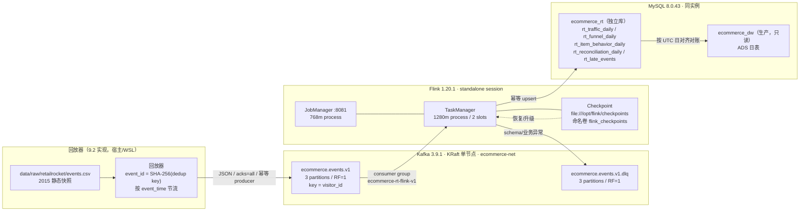

# Kafka + Flink 实时链路设计（Phase 9.1 · 基础设施与契约先行）

> 状态：**9.1 已完成**（2026-11-07）。本阶段只交付可运行的实时基础设施骨架与契约/设计，
> **不实现业务窗口聚合、回放器业务逻辑与实时结果表 DDL**（留给 9.2 / 9.3）。
>
> 上游事实基线：生产库 `ecommerce_dw` 的 13 张表行数复核不变（见 §10），
> ODS 2,756,101 / DWD 2,755,641 / DWS+ADS 9 表 / `ads_publish_log` 12。
>
> 相关文档：`docs/architecture.md`（总体架构，阶段收尾统一更新）、
> `docs/data_contract.md`（离线事件契约）、`docs/metric_definitions.md`（指标口径）、
> `docs/deployment.md`（部署手册）。

## 0. 关键决策摘要

| 决策点 | 采用方案 | 被否决方案与原因 |
| --- | --- | --- |
| Kafka 元数据协调 | **KRaft 单节点**（`apache/kafka:3.9.1`，broker+controller 同进程） | ZooKeeper 模式：多一个容器/端口/内存，单节点无 HA 收益；Kafka 3.9 已把 KRaft 作为默认生产路径。Kafka 4.x：版本更新但与 Flink 1.20 连接器/客户端兼容性未在本机验证，9.1 选已验证的 3.9.1。 |
| Flink 部署模式 | **standalone session**（JobManager + 1 TaskManager，2 slots） | application 模式：每个作业要打包独立镜像/入口，9.1 还没有业务作业，无法体现价值；且调试/冒烟需反复提交 examples。Kubernetes Operator：本机无 K8s，超出单机范围。session 模式的作业不随 JM 重启自动恢复，已在 §7.4 列为后续风险。 |
| 状态后端 | **HashMapStateBackend（堆内）** | RocksDB：需要额外本地盘与 native 库，日窗口只保留约 1.2 万访客/日的去重集合，堆内足够；等状态超过约 1 GB 再切 RocksDB。 |
| 实时结果落点 | **MySQL 独立库 `ecommerce_rt`**（同实例、不同 database，空库已建） | 写 `ecommerce_dw`：直接违反“不得写生产四层表”，且会破坏 13 表基线与批流生命周期隔离。独立 PostgreSQL：多一套引擎/连接/内存，收益仅是物理隔离；MySQL 已具备幂等 upsert，9.1 用 database 级隔离足够。ClickHouse：更适合高吞吐实时 OLAP，但需新容器/内存，且 9.2 的回放规模用不上。 |
| Topic 分区数 | **3**，副本 **1** | 1 分区：限制 Flink 并行度，无法利用 2 个 slot；6 分区：单 broker 上空增小文件与 rebalance 成本；副本 3：单 broker 无法满足。 |
| Topic key | **`visitor_id`**（字符串形式；哨兵 `"0"`） | `item_id`：商品热度长尾更极端（如 187,946 单品区间 PV 3,409），热点分区倾斜更严重；且商品维度不需要按 key 保序。`visitor_id` 能保证同一访客事件有序，便于漏斗/会话类扩展；热点访客风险用 §5.2 的监控与盐化预案处理。 |
| 消息去重键 | **`event_id` = DWD `dedup_key` 同款 SHA-256** | 随机 UUID：回放重放会重复计数，无法与离线 DWD 精确去重口径对账；自增 ID：重放不稳定。 |
| 实时结果表更新 | **主键 upsert（`INSERT ... ON DUPLICATE KEY UPDATE`）** | 先删后插：并发/重试窗口内会出现空窗；append-only：无法表达日窗口的累计修正。 |

## 1. 目标与范围

### 1.1 目标

1. 在现有批处理数仓不动的前提下，增加一条**可回放验证**的实时链路：
   回放器 → Kafka → Flink → 实时结果表 → 对账/监控。
2. 用同一份 2015 年 Retailrocket 事件，验证实时窗口结果能与离线 ADS 日表**同口径对账**。
3. 把消息契约、topic、窗口、checkpoint、结果表、监控、资源边界先钉死，9.2/9.3 只填业务实现。

### 1.2 非目标（本阶段明确不做）

- 不实现 Flink 业务作业（PV/UV/漏斗窗口、维表关联、JDBC sink）。
- 不实现回放器业务逻辑（读取 CSV、生成 `event_id`、节流发送）。
- 不建实时结果表（只建空库 `ecommerce_rt`），不写任何实时数据。
- 不改 ODS/DWD/DWS/ADS 生产表、不改 Airflow DAG、不改 Superset 看板。
- 不把实时链路接入生产流量；Retailrocket 是静态快照，实时链路是**回放验证**，不是线上流量。

### 1.3 与离线链路的关系

实时链路是**旁路**：离线链路仍是唯一权威口径。实时结果只用于低延迟观测与对账，
不反向写 `ecommerce_dw`，不替代 Airflow 日调度，不进入 `ads_publish_log` 发布审计。

## 2. 拓扑



端口与容器：

| 服务 | 容器 | 宿主机端口 | 容器内地址 |
| --- | --- | ---: | --- |
| Kafka | `ecommerce-kafka` | `KAFKA_PORT`（默认 9092）→ 19092 | `kafka:9092`（INTERNAL listener） |
| Flink JobManager | `ecommerce-flink-jobmanager` | `FLINK_UI_PORT`（默认 8081） | `flink-jobmanager:8081` |
| Flink TaskManager | `ecommerce-flink-taskmanager` | 无 | RPC 由 JM 调度 |
| MySQL | `ecommerce-mysql`（现有） | 3306 | `mysql:3306` |

## 3. 消息契约（v1）

消息为 UTF-8 JSON，Kafka key 为 `visitor_id` 的十进制字符串（哨兵为 `"0"`），
value 为事件对象。机器可读定义见 `streaming/schemas/event_v1.json`（JSON Schema 2020-12）。

### 3.1 字段

| 字段 | 类型 | 可空 | 约束/枚举 | 说明 |
| --- | --- | --- | --- | --- |
| `event_id` | string | 否 | 1–128，`[A-Za-z0-9._:-]` | 确定性事件 ID。生产回放器用与 DWD `dedup_key` 相同的 SHA-256：`SHA256(event_time_utc, visitor_id, event_type, item_id, COALESCE(transaction_id,0))`，64 位十六进制。 |
| `event_time` | string (RFC 3339) | 否 | UTC，`Z` 结尾，毫秒精度 | 业务事件时间（2015 年快照），Flink event time 与窗口依据。 |
| `ingest_time` | string (RFC 3339) | 否 | UTC，`Z` 结尾，毫秒精度 | 回放器写入 Kafka 的时刻；只用于回放延迟/吞吐监控，**不参与窗口**。 |
| `schema_version` | integer | 否 | `>= 1`，v1 = 1 | 契约主版本。 |
| `visitor_id` | integer \| null | 是 | 非空时 `>= 1` | 原始 `visitorid="0"` 的 3 行置 null，并带 `quality_flags=["visitor_zero"]`。 |
| `event_type` | string | 否 | `view` / `add_to_cart` / `transaction` | DWD 标准枚举；原始 `addtocart` 放 `raw_event_type`。 |
| `item_id` | integer | 否 | `>= 1` | 商品 ID。 |
| `transaction_id` | integer \| null | 是 | 非空时 `>= 1`；`event_type=transaction` 时必填，其他事件必须 null | 订单级标识，不是行级唯一。 |
| `raw_event_type` | string | 是 | `view` / `addtocart` / `transaction` | 可选血缘字段；保留原始拼写。 |
| `source_file` | string | 是 | — | 可选，来源 CSV basename。 |
| `source_row_number` | integer | 是 | `>= 1` | 可选，CSV 物理行号（表头 = 1）。 |
| `quality_flags` | array\<string\> | 是 | — | 可选，行级质量标记；正常为空数组。 |

示例（即 9.1 冒烟实际写入并消费的消息）：

```json
{
  "event_id": "smoke-0001",
  "event_time": "2015-09-17T12:34:56.789Z",
  "ingest_time": "2026-11-07T06:00:00.000Z",
  "schema_version": 1,
  "visitor_id": 12345,
  "event_type": "view",
  "item_id": 187946,
  "transaction_id": null
}
```

> 生产回放器的 `event_id` 不会用 `smoke-0001` 这种人工值；冒烟消息只为验证链路。

### 3.2 `event_time` 与 `ingest_time` 的边界

- **窗口/水位线只用 `event_time`**。这样实时日窗口才能与离线 `event_date_utc` 对齐。
- **延迟监控只用 `ingest_time`**。因为 `event_time` 是 2015 年，直接算
  `now - event_time` 会得到约 10 年，毫无意义。正确的回放延迟是
  `processing_time - ingest_time`。
- `ingest_time` 不进入结果表主键，也不参与去重。

### 3.3 schema_version 演进策略

1. **只做向后兼容的增量变更**（加可选字段、放宽枚举）时，`schema_version` 可不升，
   消费者必须忽略未知字段（Schema 已设 `additionalProperties: true`）。
2. **不兼容变更**（删字段、改类型、改枚举语义、`event_id` 算法变化）时：
   - `schema_version` 升主版本（v2）；
   - 新建 topic `ecommerce.events.v2`，不原地改 v1；
   - 双写/回放切换期并行消费，结果表按 `schema_version` 或独立表隔离；
   - 旧 topic 按 retention 自然过期，不删除未消费数据。
3. 消费端遇到 `schema_version` 高于自身支持版本：**不猜测、不降级解析**，
   原样写 DLQ 并告警；避免把未知语义当已知语义计数。
4. 任何契约变更必须同步更新 `streaming/schemas/event_v1.json`（或新增 v2 文件）、
   本文档与 `docs/data_contract.md` 的映射说明。

## 4. Topic 设计

| 项 | 值 |
| --- | --- |
| 事件 topic | `ecommerce.events.v1` |
| 分区数 / 副本数 | 3 / 1（单 broker） |
| key | `visitor_id` 十进制字符串；null visitor 用 `"0"` |
| cleanup.policy | `delete` |
| retention | 7 天（`retention.ms=604800000`） |
| 分区内顺序 | 同一 `visitor_id` 有序；跨分区无序 |
| 消费者组 | `ecommerce-rt-flink-v1` |
| 死信 topic | `ecommerce.events.v1.dlq`，3 分区 / RF=1，retention 14 天 |
| 自动建 topic | 关闭（`KAFKA_AUTO_CREATE_TOPICS_ENABLE=false`），必须显式建 |
| 压缩 | 不启用 `compact`；事件流是追加日志，不需要按 key 保留最新值 |

### 4.1 为什么 key 选 `visitor_id` 而不是 `item_id`

- **热点分布**：商品热度是长尾，头部单品事件量远高于普通商品；按 `item_id` 分区会让
  少数分区承载大部分流量。访客分布相对均匀（虽然也有重访客）。
- **语义**：访客维度是漏斗、留存、会话的基础；同一访客落在同一分区可保证其事件顺序，
  为 9.3 的窗口内“先浏览后交易”类逻辑留出空间。
- **热点风险与预案**：重访客/爬虫仍可能造成单 key 倾斜。9.2 监控每个分区的
  records-in 与 consumer lag；若单分区持续超过均值 3 倍，对极端 key 做
  `visitor_id#salt` 盐化（仅用于不要求访客内保序的计数指标），或把该 key 单独路由。
  盐化会破坏访客内顺序，不能无差别使用。
- **商品维度**：9.2 的商品日指标不需要 key 级顺序，可以在 Flink 内按 `item_id`
  二次聚合；不需要改 Kafka key。

### 4.2 命名约束

Kafka 对含 `.` 或 `_` 的 topic 有 metric name 冲突警告：**同一 topic 名不要混用点号与下划线**。
本项目统一用点号分层（`ecommerce.events.v1`），DLQ 用 `.dlq` 后缀，不使用下划线。

### 4.3 Producer 约定（9.2 实现）

- `acks=all`、`enable.idempotence=true`、`max.in.flight.requests.per.connection<=5`；
- 压缩建议 `lz4`（JSON 文本压缩比高，CPU 开销低）；
- 重试有界（`delivery.timeout.ms` 明确设置），失败写本地 spool 或告警，不静默丢弃；
- 不启用 Kafka 事务（`transactional.id`）作为 9.2 的默认路径：单 producer 回放场景下
  幂等 producer + 下游 `event_id` 去重已足够；若未来要求 Kafka→Kafka 端到端 exactly-once，
  再引入事务与 `read_committed`。

## 5. 语义边界：at-least-once 与端到端幂等

### 5.1 Kafka 幂等 producer 保证什么

`enable.idempotence=true` 只保证**单个 producer 会话内、单个分区**的重试不会产生重复：
producer 带 sequence number，broker 拒绝重复批次。它**不保证**：

- 应用层重复发送（回放器重跑、上游重试、双写）；
- producer 重启后新会话的重复（PID 变化）；
- 跨分区的原子性；
- 下游 sink 的重复写入。

因此“Kafka 幂等 producer”不等于“端到端 exactly-once”。

### 5.2 Flink 侧语义

- Source 在 checkpoint 中保存 Kafka offset；失败恢复时从最近成功 checkpoint 的 offset 重放，
  所以 source 是 **at-least-once**（checkpoint 之后、故障之前的事件会再次处理）。
- Kafka sink 若使用 Flink 的 `KafkaSink` + checkpoint（两阶段提交），可实现
  Kafka→Kafka 的 exactly-once；但本项目 sink 是 MySQL JDBC，**不是事务性两阶段提交**，
  所以端到端仍是 at-least-once。
- 结果表的“有效一次”靠**确定性 `event_id` + 主键 upsert**：
  - 重复事件在窗口前按 `event_id` 去重（状态 TTL ≥ 窗口 + 允许迟到）；
  - 窗口结果按 `event_date_utc`（及 `metric_name`）upsert，重复写入同值；
  - 故障恢复后重放同一窗口，最新累计值覆盖旧值，不会翻倍。

### 5.3 结论

本项目承诺：**传输 at-least-once + 结果表幂等 upsert = 有效一次（effectively-once）**。
不承诺 Kafka 事务级 exactly-once；对账时以 `event_id` 去重后的结果为准。

## 6. Flink 设计

### 6.1 时间语义

- **Event time**：`event_time`（2015 年业务时间），不是处理时间。
- **Watermark**：
  `WatermarkStrategy.forBoundedOutOfOrderness(Duration.ofSeconds(30)).withIdleness(Duration.ofMinutes(5))`。
  回放器按 `event_time` 顺序发送时 30 秒乱序容忍足够；`withIdleness` 防止某分区长时间无数据
  导致水位线停滞。
- **允许迟到**：日窗口 `allowedLateness = 24h`。日窗口在 `D+1 00:00 + watermark` 后触发，
  之后 24 小时（事件时间）内到达的迟到事件仍会更新结果；超过 24 小时进旁路审计，
  不进入结果表。
- **为什么要 24 小时**：离线 ADS 按 `event_date_utc` 全量重算，不区分到达时间；实时若只留
  几分钟迟到，回放末尾的乱序事件会漏算。24 小时覆盖本数据集的实际乱序（离线重复行仅 460 行，
  时间戳分布集中），同时状态成本可控（见 §6.5）。

### 6.2 窗口类型与每个指标的边界

所有窗口统一为 **UTC 日滚动窗口（TUMBLE, 1 day）**，边界
`[D 00:00:00.000, D+1 00:00:00.000)`，与离线 `event_date_utc` 完全一致。

| 实时指标 | 结果表/列 | 窗口 | 聚合 | 去重键 | 备注 |
| --- | --- | --- | --- | --- | --- |
| PV | `rt_traffic_daily.pv` | TUMBLE 1d | `COUNT(*)`（`event_type='view'`） | 不去重（事件行级） | 与 `ads_traffic_daily.pv` 对齐；含 `visitor_id IS NULL` 的 PV |
| UV | `rt_traffic_daily.uv` | TUMBLE 1d | `COUNT(DISTINCT visitor_id)`（`view`） | visitor_id | 排除 null visitor |
| DAU | `rt_traffic_daily.dau` | TUMBLE 1d | `COUNT(DISTINCT visitor_id)`（任意事件） | visitor_id | 排除 null visitor |
| 加购用户 | `rt_funnel_daily` (`cart_users`) | TUMBLE 1d | `COUNT(DISTINCT visitor_id)`（`add_to_cart`） | visitor_id | — |
| 交易用户 | `rt_funnel_daily` (`buyer_users`) | TUMBLE 1d | `COUNT(DISTINCT visitor_id)`（`transaction`） | visitor_id | — |
| 订单数 | `rt_funnel_daily` (`orders`) | TUMBLE 1d | `COUNT(DISTINCT transaction_id)` | transaction_id | 不能用交易事件行数 |
| 加购率 | `rt_funnel_daily` (`add_to_cart_rate`) | 同日派生 | `cart_users / view_users` | — | 分母 0 → NULL |
| 严格转化率 | `rt_funnel_daily` (`conv_strict_rate`) | 同日派生 | `conv_strict_users / view_users` | visitor_id | 需“当日既 view 又 transaction”的访客集合；9.3 实现 |
| 全局转化率 | `rt_funnel_daily` (`conv_global_rate`) | 同日派生 | `buyer_users / view_users` | visitor_id | 分子可 > 分母，合法 |
| 每日去重商品数 | `rt_item_behavior_daily` | TUMBLE 1d | `COUNT(DISTINCT item_id)` 分事件类型 | item_id | 三个列：viewed/carted/bought |

去重执行位置：**窗口前按 `event_id` 去重**（KeyedProcessFunction + ValueState TTL 48h），
再进入日窗口。这样精确对应 DWD 的 `dedup_key` 去重（460 行重复）。若不做这一步，
实时 PV 会比离线多 94 行 `view`（ODS 2,664,312 vs DWD 2,664,218），对账必然失败。

### 6.3 Checkpoint 配置

当前集群级配置（`docker-compose.yml` 的 `FLINK_PROPERTIES`）：

| 配置 | 值 | 说明 |
| --- | --- | --- |
| `execution.checkpointing.interval` | `10s` | 冒烟作业实测 chk-1 用时 175 ms |
| `execution.checkpointing.mode` | `EXACTLY_ONCE` | 状态一致性模式；sink 非事务，端到端仍按 §5 |
| `execution.checkpointing.min-pause` | `5s` | 避免 checkpoint 背靠背 |
| `execution.checkpointing.timeout` | `60s` | 超时失败，不无限挂起 |
| `state.checkpoints.num-retained` | `3` | 保留最近 3 个 |
| `state.backend.type` | `hashmap` | 堆内状态 |
| `state.checkpoints.dir` | `file:///opt/flink/checkpoints` | 命名卷 `flink_checkpoints` |
| `state.savepoints.dir` | `file:///opt/flink/savepoints` | 命名卷 `flink_savepoints` |

> 10 秒间隔对 2.76M 事件回放偏密，但状态很小（每日去重 visitor 集合），实测 checkpoint
> 15 KB、175 ms；9.2 可调到 30–60 秒，减少小文件。保留 3 个便于恢复演练。

### 6.4 状态后端与存储

- **HashMapStateBackend**：状态在 TaskManager 堆内，checkpoint 时快照到文件。
- 日窗口状态量级：每日约 1.2 万 view 访客 / 1.2 万任意事件访客，按 `Long` + 集合开销
  估算每窗口 < 5 MB；同时保留触发窗口 + 24h 迟到修正 + 48h 去重 TTL，
  最坏约 3–4 个日窗口，状态 < 50 MB。1280m TaskManager 进程内存足够。
- `file://` 只适用于单机；生产多节点必须换 HDFS/S3/OSS 等共享存储，否则 JM/TM
  跨节点无法读取 checkpoint。
- 命名卷在 `docker compose down`（不带 `-v`）后保留；`down -v` 会删除，等同于丢弃恢复点。

### 6.5 恢复演练计划（9.2 验收执行）

1. 提交带 Kafka source 的作业，等待至少 2 个 `COMPLETED` checkpoint；
2. 记录 `chk-N` 路径、offset、结果表当前值；
3. `flink stop <job_id>`（触发 savepoint）或直接 `flink cancel`（用最近 checkpoint）；
4. `flink run -s file:/opt/flink/checkpoints/<job_id>/chk-N ...` 重新提交；
5. 验证 REST `/jobs/<id>/checkpoints` 中 `"restored": 1`，且结果表无重复计数；
6. 注入一条 checkpoint 之后、故障之前的事件，确认重放后被 `event_id` 去重吸收。

9.1 只验证了 checkpoint 能落盘，未做恢复演练（无业务作业）。

## 7. 实时结果表设计（`ecommerce_rt`）

### 7.1 隔离边界

- **同实例、不同 database**：MySQL `ecommerce_rt` 已建（`utf8mb4 / utf8mb4_0900_ai_ci`，空库）。
- **禁止写 `ecommerce_dw`**：实时作业的 JDBC URL 只指向 `ecommerce_rt`；9.2 建独立账号
  `rt_app`，仅授予 `ecommerce_rt.*` 的 DML/DDL，**不授予** `ecommerce_dw` 任何权限。
- 对账作业对 `ecommerce_dw.ads_*` 只读；建议用只读账号（复用/扩展 `superset_ro` 思路，
  9.2 单独建 `rt_recon_ro`）。
- 生命周期隔离：实时表可随时 truncate/重建，不影响离线发布与 `ads_publish_log`。

### 7.2 表结构（9.2 落地 DDL）

```text
rt_traffic_daily
  event_date_utc   DATE           PK
  pv               BIGINT UNSIGNED NOT NULL DEFAULT 0
  uv               BIGINT UNSIGNED NOT NULL DEFAULT 0
  dau              BIGINT UNSIGNED NOT NULL DEFAULT 0
  window_start     DATETIME(3)    NOT NULL
  window_end       DATETIME(3)    NOT NULL
  source_watermark DATETIME(3)    NULL
  is_final         TINYINT        NOT NULL DEFAULT 0
  updated_at       DATETIME(3)    NOT NULL

rt_funnel_daily
  event_date_utc   DATE           PK(1)
  metric_name      VARCHAR(48)    PK(2)
  metric_value     DECIMAL(20,6)  NULL
  window_start     DATETIME(3)    NOT NULL
  window_end       DATETIME(3)    NOT NULL
  source_watermark DATETIME(3)    NULL
  is_final         TINYINT        NOT NULL DEFAULT 0
  updated_at       DATETIME(3)    NOT NULL

rt_item_behavior_daily
  event_date_utc   DATE           PK
  items_viewed     BIGINT UNSIGNED NOT NULL DEFAULT 0
  items_carted     BIGINT UNSIGNED NOT NULL DEFAULT 0
  items_bought     BIGINT UNSIGNED NOT NULL DEFAULT 0
  window_start     DATETIME(3)    NOT NULL
  window_end       DATETIME(3)    NOT NULL
  is_final         TINYINT        NOT NULL DEFAULT 0
  updated_at       DATETIME(3)    NOT NULL

rt_reconciliation_daily
  event_date_utc   DATE           PK(1)
  metric_name      VARCHAR(64)    PK(2)
  offline_value    DECIMAL(20,6)  NULL
  realtime_value   DECIMAL(20,6)  NULL
  abs_diff         DECIMAL(20,6)  NULL
  rel_diff         DECIMAL(12,6)  NULL
  status           VARCHAR(16)    NOT NULL   -- MATCH / DIFF / SKIP
  checked_at       DATETIME(3)    NOT NULL

rt_late_events
  event_id         VARCHAR(128)   PK
  event_time_utc   DATETIME(3)    NOT NULL
  detected_at      DATETIME(3)    NOT NULL
  lateness_ms      BIGINT         NOT NULL
  reason           VARCHAR(64)    NOT NULL
  payload          JSON           NOT NULL
```

### 7.3 幂等 upsert 策略

- 主键即粒度：日表 `event_date_utc`，漏斗长表 `(event_date_utc, metric_name)`。
- 写入统一用：

```sql
INSERT INTO rt_traffic_daily (event_date_utc, pv, uv, dau, window_start, window_end,
                              source_watermark, is_final, updated_at)
VALUES (?, ?, ?, ?, ?, ?, ?, ?, ?)
ON DUPLICATE KEY UPDATE
  pv = VALUES(pv), uv = VALUES(uv), dau = VALUES(dau),
  window_start = VALUES(window_start), window_end = VALUES(window_end),
  source_watermark = GREATEST(COALESCE(source_watermark, '1970-01-01'), VALUES(source_watermark)),
  is_final = VALUES(is_final), updated_at = VALUES(updated_at);
```

- 防旧覆盖新：同一窗口的结果是**累计值**，后到的重放/迟到修正只会更完整；
  `source_watermark` 记录生成该结果时的水位线，便于审计。若未来出现多作业并发写同一窗口，
  必须加 `result_version` 或仅允许单写者（9.2 默认单作业，串行）。
- `is_final=1` 仅在窗口越过 `day_end + allowed_lateness` 且水位线确认后写；此前为 0，
  下游查询应把 0 当作“进行中/可能修正”。

### 7.4 与 ADS 离线表的对照

| 实时表 | 离线对照表 | 对齐列 | 差异 |
| --- | --- | --- | --- |
| `rt_traffic_daily` | `ads_traffic_daily` | `event_date_utc`, `pv`, `uv`, `dau` | 实时有 `is_final` / `updated_at`；离线有 `is_full_day` / `build_id` |
| `rt_funnel_daily` | `ads_funnel_daily` | `(event_date_utc, metric_name)`, `metric_value` | 实时先只落可直接窗口化的指标；严格转化 9.3 |
| `rt_item_behavior_daily` | `ads_item_behavior_daily` | `event_date_utc`, 三个 distinct 商品数 | 实时不写 Top-100 排行（9.3） |
| — | `ads_item_ranking_daily` | — | 实时排行需要全量排序，9.3 单独设计 |
| — | `ads_retention_cohort` | — | 留存是跨日 cohort，实时化收益低，暂不做 |
| `rt_reconciliation_daily` | 无 | — | 新增对账审计表 |

## 8. 离线 vs 实时同口径对账

### 8.1 对齐规则

1. **窗口**：都用 UTC 日 `[D 00:00:00, D+1 00:00:00)`。
2. **时区**：全链路 UTC，不做本地时区换算；`event_time` 必须带 `Z`。
3. **去重**：实时在窗口前按 `event_id`（= DWD `dedup_key`）去重；离线用 `dwd_events`
   精确去重。两边必须是同一套业务键，否则 PV 差 94 行、加购差 366 行。
4. **部分日**：只对 `is_full_day=1` 的日期对账；2015-05-03 / 2015-09-18 标 `SKIP`。
5. **迟到**：对账在回放结束、水位线越过 `D+1 + 24h` 后执行；超过允许迟到的行进入
   `rt_late_events`，在对账结果中单列解释，不混入 diff。
6. **NULL visitor**：实时 `visitor_id=null` 计入 PV，不计入 UV/DAU；离线同规则。
7. **订单**：两边都是 `COUNT(DISTINCT transaction_id)`，不求和 `order_cnt`。

### 8.2 对账 SQL 骨架

```sql
SELECT
  o.event_date_utc,
  'pv' AS metric_name,
  o.pv AS offline_value,
  r.pv AS realtime_value,
  r.pv - o.pv AS abs_diff,
  CASE WHEN o.pv = 0 THEN NULL ELSE (r.pv - o.pv) / o.pv END AS rel_diff,
  CASE WHEN o.pv = r.pv THEN 'MATCH' ELSE 'DIFF' END AS status
FROM ecommerce_dw.ads_traffic_daily o
JOIN ecommerce_rt.rt_traffic_daily r USING (event_date_utc)
WHERE o.is_full_day = 1
  AND r.is_final = 1
  AND o.event_date_utc BETWEEN ? AND ?;
```

### 8.3 差异解释清单

出现 DIFF 时按顺序排查：

1. **去重不一致**：`event_id` 是否按 DWD `dedup_key` 生成；去重状态 TTL 是否短于窗口+迟到。
2. **迟到超限**：`rt_late_events` 是否有该日事件；允许迟到是否小于实际乱序。
3. **窗口边界**：是否用了本地时区或 `[D, D+1)` 之外的开闭区间。
4. **部分日**：是否误把 `is_full_day=0` 纳入。
5. **null visitor**：UV/DAU 是否把 null 算进去。
6. **订单口径**：是否误用交易事件行数或 `order_cnt` 求和。
7. **重复回放**：`event_id` 是否稳定；回放器是否生成了随机 ID。
8. **事务跨日**：同一 `transaction_id` 是否跨日出现；离线按事件日计数，实时也必须按事件日。

## 9. 监控指标

| 指标 | 定义/来源 | 目标/告警建议 |
| --- | --- | --- |
| 回放端到端延迟 | `processing_time - ingest_time`（p50/p95） | p95 < 5s；持续 > 30s 告警 |
| 事件时间水位线滞后 | `max_event_time_seen - watermark` | < 60s（正常回放） |
| 吞吐 | Kafka records-in / Flink numRecordsInPerSecond | 达到回放目标速率，无持续下降 |
| Kafka 积压 | `kafka-consumer-groups.sh --describe --group ecommerce-rt-flink-v1` 的 LAG | < 10,000 条且 < 60s |
| 迟到比例 | `rt_late_events` 行数 / 总事件数（按日） | < 0.1%；突增告警 |
| checkpoint 成功率 | REST `/jobs/<id>/checkpoints` 的 completed/(completed+failed) | >= 99% |
| checkpoint 耗时/大小 | REST summary `end_to_end_duration` / `state_size` | p95 < 10s；< 100MB（9.1 实测 175ms / 15KB） |
| DLQ 速率 | DLQ topic 消息数 / 总消息数 | < 0.01%；任何 schema 错误都应告警 |
| 结果新鲜度 | `MAX(updated_at)` per `event_date_utc` | 回放期间滞后 < 2 个 checkpoint 间隔 |
| 作业重启次数 | Flink REST `numRestarts` | 5 分钟内 > 3 次告警 |

采集方式（9.2 落地）：

- Kafka：`kafka-consumer-groups.sh --bootstrap-server localhost:9092 --describe --group ecommerce-rt-flink-v1`；
- Flink：REST `http://localhost:8081/jobs`、`/jobs/<id>/checkpoints`、`/jobs/<id>/metrics`；
- MySQL：对账表 `rt_reconciliation_daily` + 结果表 `updated_at`；
- 可选 Prometheus/Grafana：本机未部署，9.2 不引入新容器，先用 REST + 定时 SQL。

## 10. 资源预算与容量结论（基于 WSL2 实测）

### 10.1 实测环境

- WSL2 Ubuntu 24.04，Docker Engine；`nproc=8`；内存 7.8 GiB；swap 4.0 GiB；
  根盘 1007 GiB（可用 918 GiB）。
- 现有栈：MySQL、PostgreSQL、Airflow scheduler/webserver、Superset；另有 4 个与本项目
  无关的 `wall-agent*` 容器（合计约 390 MiB），不纳入本项目预算但占用宿主机内存。

### 10.2 启动前（仅现有栈）

```text
free -h:  total 7.8Gi  used 2.4Gi  free 253Mi  buff/cache 5.3Gi  available 5.3Gi
swap:     total 4.0Gi  used 3.4Gi  free 619Mi
df -h /:  1007G total, 36G used, 920G avail (4%)
```

| 容器 | 内存 |
| --- | ---: |
| ecommerce-mysql | 3.752 GiB |
| ecommerce-airflow-webserver | 994.6 MiB |
| ecommerce-airflow-scheduler | 496.9 MiB |
| ecommerce-postgres | 60.37 MiB |
| ecommerce-superset | 44.13 MiB |
| wall-agent1–4（非本项目） | 约 440 MiB |

### 10.3 启动 Kafka + Flink 后

```text
free -h:  total 7.8Gi  used 3.6Gi  free 330Mi  buff/cache 4.1Gi  available 4.1Gi
swap:     total 4.0Gi  used 3.4Gi  free 586Mi
df -h /:  1007G total, 39G used, 918G avail (5%)
```

| 容器 | 实测内存 | 限制 |
| --- | ---: | ---: |
| ecommerce-kafka | 439.1 MiB | 1 GiB |
| ecommerce-flink-jobmanager | 356.4 MiB | 1 GiB |
| ecommerce-flink-taskmanager | 396.9 MiB | 1.5 GiB |
| **新增合计** | **约 1.19 GiB** | **3.5 GiB（上限和）** |
| ecommerce-mysql（同一时刻） | 2.168 GiB | 无显式限制 |
| airflow webserver + scheduler | 1.35 GiB | 无显式限制 |
| postgres + superset | 101.5 MiB | 无显式限制 |

磁盘：根盘可用从 920 GiB 降到 918 GiB；其中 `kafka_data` 首次启动后实测约 **1.195 GB**
（KRaft 元数据 topic + 日志段预分配，属固定开销，不随一条冒烟消息线性增长）。
`flink_checkpoints` / `flink_savepoints` 当前仅 60 KB 级。剩余 918 GiB 对回放数据与
checkpoint 足够。

### 10.4 据此做出的配置

- **Kafka**：`KAFKA_HEAP_OPTS=-Xms256m -Xmx512m`，容器 `mem_limit=1g`。
  实测 RSS 439 MiB，距上限约 580 MiB；单 broker + 3 分区 + 低吞吐回放足够。
- **Flink JobManager**：`jobmanager.memory.process.size=768m`，容器 `mem_limit=1g`。
  实测 356 MiB。
- **Flink TaskManager**：`taskmanager.memory.process.size=1280m`，容器 `mem_limit=1536m`，
  2 slots。实测 397 MiB（仅运行 examples 小作业；业务作业会上升，1280m 为预留）。
- **总上限 3.5 GiB**，当前实际新增 1.19 GiB；`available 4.1 GiB`，余量约 2.9 GiB。
- **不分阶段常驻**：swap 已用 3.4 GiB，说明宿主长期有内存压力。建议：
  - 做实时开发/回放时再起三个服务，平时可停；
  - 跑全量 ODS 装载 / DWD / DWS 全量重建前，先停 Flink TaskManager（最占内存）
    或整组实时服务，避免与 batch 构建抢内存；
  - 不要同时跑“全量 23M 行重载 + 实时回放 + Superset 重查询”。

启停命令：

```bash
# 起（只起实时组，不动现有栈）
docker compose up -d kafka flink-jobmanager flink-taskmanager

# 停（先停 Flink，再停 Kafka；避免作业在 Kafka 消失后反复失败）
docker compose stop flink-taskmanager flink-jobmanager kafka
```

### 10.5 容量结论（规划值，非吞吐压测）

- 3 分区 / RF=1 / 512m heap 的 Kafka，对 2.76M 条小 JSON 的离线回放绰绰有余；
  按 1,500 条/秒约 31 分钟、5,000 条/秒约 9 分钟，单 broker 不构成瓶颈。
- Flink 2 slots 足以承载日窗口 PV/UV/DAU + 简单漏斗；状态 < 50 MB，checkpoint 15 KB 量级。
- 结果表规模：139 个日 × 3 张日表 + 139 × N 漏斗行，远小于离线 ADS；MySQL 同实例无压力。
- 真正的瓶颈是**宿主内存**，不是 Kafka/Flink 吞吐；因此内存上限按实测收紧，不按“默认推荐值”放大。

### 10.6 WSL2 重启/内存压力影响

- 容器均为 `restart: unless-stopped`；Docker daemon 随 WSL 启动后会自动拉起 Kafka/Flink。
- **Kafka**：KRaft 元数据与日志在命名卷 `kafka_data`，重启后恢复；非正常关机可能触发
  log recovery，启动变慢但数据不丢。不要删除该卷；删除等于换集群。
- **Flink**：JM/TM 会重启，但 **session 集群不会自动重新提交作业**；作业需手工
  `flink run -s <checkpoint>` 恢复。checkpoint/savepoint 在命名卷中保留。
  若要求自动恢复，9.3 应改 application 模式 + 外部编排（或 Flink HA + 持久化作业）。
- **内存**：WSL2 当前 7.8 GiB + 4 GiB swap，swap 已用 3.4 GiB。若后续同时跑全量构建，
  建议在 `C:\Users\<user>\.wslconfig` 提高 `memory`（例如 12GB）并 `wsl --shutdown` 重启；
  本阶段**未修改**宿主配置，避免影响现有栈。
- **checkpoint 本地卷**：WSL 重启不影响；`docker compose down -v` 会删除，必须避免。

## 11. 9.1 验收证据

| 项 | 结果 |
| --- | --- |
| `docker compose config -q` | 通过（`CONFIG_OK`） |
| 全栈 `docker compose up -d` | 原有 5 服务 + 新增 3 服务全部 healthy；airflow-init / superset-init `Exited (0)` |
| Kafka 版本 | 3.9.1（`kafka-topics.sh --version`） |
| Kafka topic | `ecommerce.events.v1` 3 分区 / RF=1；`ecommerce.events.v1.dlq` 3 分区 / RF=1 |
| Kafka roundtrip | 生产 key `12345` + JSON，消费回同一消息；end offsets `0:0, 1:0, 2:1` |
| Flink 版本 | 1.20.1，commit `cb1e7b5` |
| Flink 集群 | 1 TaskManager，2 slots；REST `/overview` 正常 |
| Flink 作业 | `StateMachineExample.jar`，JobID `5720285169fc32b99550ef0596e7b3e4`，RUNNING |
| Checkpoint | `chk-1` COMPLETED，路径 `file:/opt/flink/checkpoints/5720285169fc32b99550ef0596e7b3e4/chk-1`，15,431 bytes，175 ms；`chk-2` 也已落盘 |
| 清理 | `flink cancel` 成功；`flink list` 显示 `No running jobs` |
| 独立结果库 | `ecommerce_rt` 已建，`utf8mb4_0900_ai_ci`，0 张表（9.2 建表） |
| 生产基线 | 13 张表逐表 MATCH（见 §11.1） |
| 代码质量 | `ruff check . && ruff format --check .` 全绿；`python -m pytest` exit 0 |

镜像来源：Docker Hub 直连不稳定，实际通过镜像源拉取后打回标准名：

```bash
docker pull docker.1ms.run/apache/kafka:3.9.1
docker tag  docker.1ms.run/apache/kafka:3.9.1 apache/kafka:3.9.1
docker pull docker.1ms.run/flink:1.20.1-scala_2.12-java17
docker tag  docker.1ms.run/flink:1.20.1-scala_2.12-java17 flink:1.20.1-scala_2.12-java17
# Flink 再基于官方镜像做最小构建（预建 checkpoint/savepoint 目录）
docker compose build flink-jobmanager flink-taskmanager
```

- Kafka 镜像 digest：`sha256:4ceccc577f03f51f6af8dbfda55194d0d892f4fa7913ffbded567ce3895622ed`
- Flink 自定义镜像：`ecommerce-flink:1.20.1-scala_2.12-java17`
  （`dbafafb7d265`，基于 `flink:1.20.1-scala_2.12-java17`）
- topic 级配置已显式写入：`cleanup.policy=delete`、
  `retention.ms=604800000`（7 天）/ DLQ `1209600000`（14 天）。

### 11.1 生产基线 13 表复核（9.1 执行前后一致）

| 表 | 期望 | 实测 | 状态 |
| --- | ---: | ---: | --- |
| `ods_events_raw` | 2,756,101 | 2,756,101 | OK |
| `dwd_events` | 2,755,641 | 2,755,641 | OK |
| `dws_user_daily` | 1,649,534 | 1,649,534 | OK |
| `dws_item_daily` | 1,672,186 | 1,672,186 | OK |
| `dws_category_daily` | 94,194 | 94,194 | OK |
| `ads_traffic_daily` | 139 | 139 | OK |
| `ads_funnel_daily` | 1,251 | 1,251 | OK |
| `ads_item_ranking_daily` | 13,900 | 13,900 | OK |
| `ads_retention_cohort` | 278 | 278 | OK |
| `etl_watermark` | 139 | 139 | OK |
| `ads_funnel_interval` | 1 | 1 | OK |
| `ads_item_behavior_daily` | 139 | 139 | OK |
| `ads_publish_log` | 12 | 12 | OK |

## 12. 风险与后续

| 风险 | 影响 | 缓解 |
| --- | --- | --- |
| WSL2 内存/swap 压力 | 构建或实时作业被 OOM kill；VM 重启 | 分阶段启停；不在全量构建时跑 Flink；必要时提高 `.wslconfig` 内存 |
| 单 broker RF=1 | broker 故障即不可用/丢数据 | 本地回放可接受；生产必须 3 broker + RF=3 |
| session 集群不自动恢复作业 | WSL/容器重启后实时链路停摆 | 9.3 改 application 模式或外部 resubmit；checkpoint 保留 |
| checkpoint 在本地卷 | 宿主盘故障即丢失恢复点 | 生产换 HDFS/S3；本地至少保留命名卷，避免 `down -v` |
| `event_id` 不稳定 | 回放重复计数，对账失败 | 回放器固定用 DWD `dedup_key` 算法；单测覆盖 |
| 热点 key | 单分区积压 | 监控分区 lag；极端 key 盐化（仅非保序指标） |
| schema 演进 | 消费端解析失败 | 未知主版本进 DLQ；不原地改 v1；v2 新 topic |
| 严格转化/排行/留存未实时化 | 指标覆盖不全 | 9.3 按优先级补；9.1/9.2 先保证流量与漏斗基础指标 |
| 事件时间 2015 与处理时间混淆 | 延迟指标失真 | 明确 `event_time` 只做窗口、`ingest_time` 只做延迟（§3.2） |
| `docker compose down -v` | 删除 Kafka/Flink/MySQL 卷 | 生产项目严禁 `-v`；只在 fresh overlay 清理 |

### 后续阶段交接

- **9.2**：回放器（CSV → `event_id` → Kafka，节流/断点）、Flink 作业（去重 → 日窗口 →
  JDBC upsert）、`ecommerce_rt` DDL 与 `rt_app` 最小权限、对账脚本、恢复演练。
- **9.3**：严格转化率、商品排行、留存、迟到旁路、监控告警、application 模式/自动恢复、
  与 Airflow/Superset 的展示衔接（只读 `ecommerce_rt`，不改现有看板）。
- 阶段收尾再统一更新 `README.md`、`docs/architecture.md`、`docs/deployment.md`；
  本阶段按约束**未改**这三份文档。
