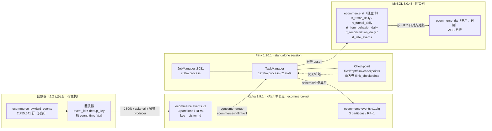

# Kafka + Flink 实时链路设计（Phase 9.1–9.4 · 基础设施、回放、校验、实时作业与全量对账）

> 状态：**9.1 / 9.2 / 9.3 / 9.4 已完成**（2026-11-07）。9.1 交付 Kafka/Flink 基础设施与消息契约；
> 9.2 交付 DWD 回放器、schema 校验/DLQ 消费者、`ecommerce_rt` 5 张结果表 DDL 与最小权限账号；
> 9.3 交付 Flink DataStream 业务作业（`event_id` 去重 → UTC 日窗口 → JDBC upsert）、
> 独立 SQL 对账脚本，并完成真实回放验收、cancel/restore 演练与 DLQ 容错验证
> （JobID `c2bc776cd60fab3afd2ca80a5e2c071e`，39/39 指标 MATCH，详见 §11.3）。
> 9.4 交付 20 批全量回放编排、全量对账审计表（1,781 MATCH / 0 DIFF / 26 SKIP）、
> 延迟指标与吞吐/反压容量验收（详见 §11.4）。
>
> 上游事实基线：生产库 `ecommerce_dw` 的 13 张表行数复核不变（见 §10），
> ODS 2,756,101 / DWD 2,755,641 / DWS+ADS 9 表 / `ads_publish_log` 12。
>
> 相关文档：`docs/architecture.md`（总体架构，阶段收尾统一更新）、
> `docs/data_contract.md`（离线事件契约）、`docs/metric_definitions.md`（指标口径）、
> `docs/deployment.md`（部署手册）。

## 0. 关键决策摘要

| 决策点 | 采用方案 | 被否决方案与原因 |
| --- | --- | --- |
| Kafka 元数据协调 | **KRaft 单节点**（`apache/kafka:3.9.1`，broker+controller 同进程） | ZooKeeper 模式：多一个容器/端口/内存，单节点无 HA 收益；Kafka 3.9 已把 KRaft 作为默认生产路径。Kafka 4.x：版本更新但与 Flink 1.20 连接器/客户端兼容性未在本机验证，9.1 选已验证的 3.9.1。 |
| Flink 部署模式 | **standalone session**（JobManager + 1 TaskManager，2 slots） | application 模式：每个作业要打包独立镜像/入口，9.1 还没有业务作业，无法体现价值；且调试/冒烟需反复提交 examples。Kubernetes Operator：本机无 K8s，超出单机范围。session 模式的作业不随 JM 重启自动恢复，已在 §7.4 列为后续风险。 |
| 状态后端 | **HashMapStateBackend（堆内）** | RocksDB：需要额外本地盘与 native 库，日窗口只保留约 1.2 万访客/日的去重集合，堆内足够；等状态超过约 1 GB 再切 RocksDB。 |
| 实时结果落点 | **MySQL 独立库 `ecommerce_rt`**（同实例、不同 database，空库已建） | 写 `ecommerce_dw`：直接违反“不得写生产四层表”，且会破坏 13 表基线与批流生命周期隔离。独立 PostgreSQL：多一套引擎/连接/内存，收益仅是物理隔离；MySQL 已具备幂等 upsert，9.1 用 database 级隔离足够。ClickHouse：更适合高吞吐实时 OLAP，但需新容器/内存，且 9.2 的回放规模用不上。 |
| Topic 分区数 | **3**，副本 **1** | 1 分区：限制 Flink 并行度，无法利用 2 个 slot；6 分区：单 broker 上空增小文件与 rebalance 成本；副本 3：单 broker 无法满足。 |
| Topic key | **`visitor_id`**（字符串形式；哨兵 `"0"`） | `item_id`：商品热度长尾更极端（如 187,946 单品区间 PV 3,409），热点分区倾斜更严重；且商品维度不需要按 key 保序。`visitor_id` 能保证同一访客事件有序，便于漏斗/会话类扩展；热点访客风险用 §5.2 的监控与盐化预案处理。 |
| 消息去重键 | **`event_id` = DWD `dedup_key` 同款 SHA-256** | 随机 UUID：回放重放会重复计数，无法与离线 DWD 精确去重口径对账；自增 ID：重放不稳定。 |
| 实时结果表更新 | **主键 upsert（`INSERT ... ON DUPLICATE KEY UPDATE`）** | 先删后插：并发/重试窗口内会出现空窗；append-only：无法表达日窗口的累计修正。 |

## 1. 目标与范围

### 1.1 目标

1. 在现有批处理数仓不动的前提下，增加一条**可回放验证**的实时链路：
   回放器 → Kafka → Flink → 实时结果表 → 对账/监控。
2. 用同一份 2015 年 Retailrocket 事件，验证实时窗口结果能与离线 ADS 日表**同口径对账**。
3. 把消息契约、topic、窗口、checkpoint、结果表、监控、资源边界先钉死，9.2/9.3 分阶段实现（均已完成）。

### 1.2 非目标（本阶段明确不做）

- ~~不实现 Flink 业务作业（PV/UV/漏斗窗口、维表关联、JDBC sink）——9.3。~~
  9.3 已实现日窗口、去重与 JDBC sink；维表关联仍未做。
- ~~不实现回放器业务逻辑~~：9.2 已实现回放器，数据源为 `dwd_events`（见 §11.2 偏差 1）。
- ~~不建实时结果表~~：9.2 已建 5 张表，9.3 已由 Flink 作业写入 3 张指标表；
  `rt_reconciliation_daily` 仍由对账工具按需使用，作业不写。
- 不改 ODS/DWD/DWS/ADS 生产表、不改 Airflow DAG、不改 Superset 看板。
- 不把实时链路接入生产流量；Retailrocket 是静态快照，实时链路是**回放验证**，不是线上流量。

### 1.3 与离线链路的关系

实时链路是**旁路**：离线链路仍是唯一权威口径。实时结果只用于低延迟观测与对账，
不反向写 `ecommerce_dw`，不替代 Airflow 日调度，不进入 `ads_publish_log` 发布审计。

## 2. 拓扑



端口与容器：

| 服务 | 容器 | 宿主机端口 | 容器内地址 |
| --- | --- | ---: | --- |
| Kafka | `ecommerce-kafka` | `KAFKA_PORT`（默认 9092）→ 19092 | `kafka:9092`（INTERNAL listener） |
| Flink JobManager | `ecommerce-flink-jobmanager` | `FLINK_UI_PORT`（默认 8081） | `flink-jobmanager:8081` |
| Flink TaskManager | `ecommerce-flink-taskmanager` | 无 | RPC 由 JM 调度 |
| MySQL | `ecommerce-mysql`（现有） | 3306 | `mysql:3306` |

## 3. 消息契约（v1）

消息为 UTF-8 JSON，Kafka key 为 `visitor_id` 的十进制字符串（哨兵为 `"0"`），
value 为事件对象。机器可读定义见 `streaming/schemas/event_v1.json`（JSON Schema 2020-12）。

### 3.1 字段

| 字段 | 类型 | 可空 | 约束/枚举 | 说明 |
| --- | --- | --- | --- | --- |
| `event_id` | string | 否 | 1–128，`[A-Za-z0-9._:-]` | 确定性事件 ID。生产回放器用与 DWD `dedup_key` 相同的 SHA-256：`SHA256(event_time_utc, visitor_id, event_type, item_id, COALESCE(transaction_id,0))`，64 位十六进制。 |
| `event_time` | string (RFC 3339) | 否 | UTC，`Z` 结尾，毫秒精度 | 业务事件时间（2015 年快照），Flink event time 与窗口依据。 |
| `ingest_time` | string (RFC 3339) | 否 | UTC，`Z` 结尾，毫秒精度 | 回放器写入 Kafka 的时刻；只用于回放延迟/吞吐监控，**不参与窗口**。 |
| `schema_version` | integer | 否 | `>= 1`，v1 = 1 | 契约主版本。 |
| `visitor_id` | integer \| null | 是 | 非空时 `>= 1` | 原始 `visitorid="0"` 的 3 行置 null，并带 `quality_flags=["visitor_zero"]`。 |
| `event_type` | string | 否 | `view` / `add_to_cart` / `transaction` | DWD 标准枚举；原始 `addtocart` 放 `raw_event_type`。 |
| `item_id` | integer | 否 | `>= 1` | 商品 ID。 |
| `transaction_id` | integer \| null | 是 | 非空时 `>= 0`；`event_type=transaction` 时必填，其他事件必须 null | 订单级标识，不是行级唯一。0 是源数据合法值：`events.csv` 第 271795 行 `transactionid=0`，DWD 保留、ADS 计为一笔订单，实时侧同口径保留（9.4 全量对账发现，见 §11.4 偏差 1）。 |
| `raw_event_type` | string | 是 | `view` / `addtocart` / `transaction` | 可选血缘字段；保留原始拼写。 |
| `source_file` | string | 是 | — | 可选，来源 CSV basename。 |
| `source_row_number` | integer | 是 | `>= 1` | 可选，CSV 物理行号（表头 = 1）。 |
| `quality_flags` | array\<string\> | 是 | — | 可选，行级质量标记；正常为空数组。 |

示例（即 9.1 冒烟实际写入并消费的消息）：

```json
{
  "event_id": "smoke-0001",
  "event_time": "2015-09-17T12:34:56.789Z",
  "ingest_time": "2026-11-07T06:00:00.000Z",
  "schema_version": 1,
  "visitor_id": 12345,
  "event_type": "view",
  "item_id": 187946,
  "transaction_id": null
}
```

> 生产回放器的 `event_id` 不会用 `smoke-0001` 这种人工值；冒烟消息只为验证链路。

### 3.2 `event_time` 与 `ingest_time` 的边界

- **窗口/水位线只用 `event_time`**。这样实时日窗口才能与离线 `event_date_utc` 对齐。
- **延迟监控只用 `ingest_time`**。因为 `event_time` 是 2015 年，直接算
  `now - event_time` 会得到约 10 年，毫无意义。正确的回放延迟是
  `processing_time - ingest_time`。
- `ingest_time` 不进入结果表主键，也不参与去重。

### 3.3 schema_version 演进策略

1. **只做向后兼容的增量变更**（加可选字段、放宽枚举）时，`schema_version` 可不升，
   消费者必须忽略未知字段（Schema 已设 `additionalProperties: true`）。
2. **不兼容变更**（删字段、改类型、改枚举语义、`event_id` 算法变化）时：
   - `schema_version` 升主版本（v2）；
   - 新建 topic `ecommerce.events.v2`，不原地改 v1；
   - 双写/回放切换期并行消费，结果表按 `schema_version` 或独立表隔离；
   - 旧 topic 按 retention 自然过期，不删除未消费数据。
3. 消费端遇到 `schema_version` 高于自身支持版本：**不猜测、不降级解析**，
   原样写 DLQ 并告警；避免把未知语义当已知语义计数。
4. 任何契约变更必须同步更新 `streaming/schemas/event_v1.json`（或新增 v2 文件）、
   本文档与 `docs/data_contract.md` 的映射说明。

## 4. Topic 设计

| 项 | 值 |
| --- | --- |
| 事件 topic | `ecommerce.events.v1` |
| 分区数 / 副本数 | 3 / 1（单 broker） |
| key | `visitor_id` 十进制字符串；null visitor 用 `"0"` |
| cleanup.policy | `delete` |
| retention | 7 天（`retention.ms=604800000`） |
| 分区内顺序 | 同一 `visitor_id` 有序；跨分区无序 |
| 消费者组 | `ecommerce-rt-flink-v1` |
| 死信 topic | `ecommerce.events.v1.dlq`，3 分区 / RF=1，retention 14 天 |
| 自动建 topic | 关闭（`KAFKA_AUTO_CREATE_TOPICS_ENABLE=false`），必须显式建 |
| 压缩 | 不启用 `compact`；事件流是追加日志，不需要按 key 保留最新值 |

### 4.1 为什么 key 选 `visitor_id` 而不是 `item_id`

- **热点分布**：商品热度是长尾，头部单品事件量远高于普通商品；按 `item_id` 分区会让
  少数分区承载大部分流量。访客分布相对均匀（虽然也有重访客）。
- **语义**：访客维度是漏斗、留存、会话的基础；同一访客落在同一分区可保证其事件顺序，
  为 9.3 的窗口内“先浏览后交易”类逻辑留出空间。
- **热点风险与预案**：重访客/爬虫仍可能造成单 key 倾斜。9.2 监控每个分区的
  records-in 与 consumer lag；若单分区持续超过均值 3 倍，对极端 key 做
  `visitor_id#salt` 盐化（仅用于不要求访客内保序的计数指标），或把该 key 单独路由。
  盐化会破坏访客内顺序，不能无差别使用。
- **商品维度**：9.2 的商品日指标不需要 key 级顺序，可以在 Flink 内按 `item_id`
  二次聚合；不需要改 Kafka key。

### 4.2 命名约束

Kafka 对含 `.` 或 `_` 的 topic 有 metric name 冲突警告：**同一 topic 名不要混用点号与下划线**。
本项目统一用点号分层（`ecommerce.events.v1`），DLQ 用 `.dlq` 后缀，不使用下划线。

### 4.3 Producer 约定（9.2 已实现）

- `acks=all`、`enable.idempotence=true`、`max.in.flight.requests.per.connection<=5`；
- 压缩建议 `lz4`（JSON 文本压缩比高，CPU 开销低）；
- 重试有界（`delivery.timeout.ms` 明确设置），失败写本地 spool 或告警，不静默丢弃；
- 不启用 Kafka 事务（`transactional.id`）作为 9.2 的默认路径：单 producer 回放场景下
  幂等 producer + 下游 `event_id` 去重已足够；若未来要求 Kafka→Kafka 端到端 exactly-once，
  再引入事务与 `read_committed`。

## 5. 语义边界：at-least-once 与端到端幂等

### 5.1 Kafka 幂等 producer 保证什么

`enable.idempotence=true` 只保证**单个 producer 会话内、单个分区**的重试不会产生重复：
producer 带 sequence number，broker 拒绝重复批次。它**不保证**：

- 应用层重复发送（回放器重跑、上游重试、双写）；
- producer 重启后新会话的重复（PID 变化）；
- 跨分区的原子性；
- 下游 sink 的重复写入。

因此“Kafka 幂等 producer”不等于“端到端 exactly-once”。

### 5.2 Flink 侧语义

- Source 在 checkpoint 中保存 Kafka offset；失败恢复时从最近成功 checkpoint 的 offset 重放，
  所以 source 是 **at-least-once**（checkpoint 之后、故障之前的事件会再次处理）。
- Kafka sink 若使用 Flink 的 `KafkaSink` + checkpoint（两阶段提交），可实现
  Kafka→Kafka 的 exactly-once；但本项目 sink 是 MySQL JDBC，**不是事务性两阶段提交**，
  所以端到端仍是 at-least-once。
- 结果表的“有效一次”靠**确定性 `event_id` + 主键 upsert**：
  - 重复事件在窗口前按 `event_id` 去重（状态 TTL ≥ 窗口 + 允许迟到）；
  - 窗口结果按 `event_date_utc`（及 `metric_name`）upsert，重复写入同值；
  - 故障恢复后重放同一窗口，最新累计值覆盖旧值，不会翻倍。

### 5.3 结论

本项目承诺：**传输 at-least-once + 结果表幂等 upsert = 有效一次（effectively-once）**。
不承诺 Kafka 事务级 exactly-once；对账时以 `event_id` 去重后的结果为准。

## 6. Flink 设计

> **9.3 实现状态**：已按本节实现为 Java DataStream 作业
> `streaming/flink-job/src/main/java/com/ecommerce/rt/`，作业名 `ecommerce-rt-daily-metrics`，
> 并行度 2，源码与构建脚本见 §11.3.1。实现偏差：connector 版本改为 3.3.0-1.20（偏差 1）、
> `is_final` 由独立 `FinalizeFunction` 在 `window_end + 24h` 定时发出（偏差 3）。
> 迟到旁路已接线（`rt_late_events`），本数据集未产生迟到行（偏差 4）。

### 6.1 时间语义

- **Event time**：`event_time`（2015 年业务时间），不是处理时间。
- **Watermark**：
  `WatermarkStrategy.forBoundedOutOfOrderness(Duration.ofSeconds(30)).withIdleness(Duration.ofMinutes(5))`。
  回放器按 `event_time` 顺序发送时 30 秒乱序容忍足够；`withIdleness` 防止某分区长时间无数据
  导致水位线停滞。
- **允许迟到**：日窗口 `allowedLateness = 24h`。日窗口在 `D+1 00:00 + watermark` 后触发，
  之后 24 小时（事件时间）内到达的迟到事件仍会更新结果；超过 24 小时进旁路审计，
  不进入结果表。
- **为什么要 24 小时**：离线 ADS 按 `event_date_utc` 全量重算，不区分到达时间；实时若只留
  几分钟迟到，回放末尾的乱序事件会漏算。24 小时覆盖本数据集的实际乱序（离线重复行仅 460 行，
  时间戳分布集中），同时状态成本可控（见 §6.5）。

### 6.2 窗口类型与每个指标的边界

所有窗口统一为 **UTC 日滚动窗口（TUMBLE, 1 day）**，边界
`[D 00:00:00.000, D+1 00:00:00.000)`，与离线 `event_date_utc` 完全一致。

| 实时指标 | 结果表/列 | 窗口 | 聚合 | 去重键 | 备注 |
| --- | --- | --- | --- | --- | --- |
| PV | `rt_traffic_daily.pv` | TUMBLE 1d | `COUNT(*)`（`event_type='view'`） | 不去重（事件行级） | 与 `ads_traffic_daily.pv` 对齐；含 `visitor_id IS NULL` 的 PV |
| UV | `rt_traffic_daily.uv` | TUMBLE 1d | `COUNT(DISTINCT visitor_id)`（`view`） | visitor_id | 排除 null visitor |
| DAU | `rt_traffic_daily.dau` | TUMBLE 1d | `COUNT(DISTINCT visitor_id)`（任意事件） | visitor_id | 排除 null visitor |
| 加购用户 | `rt_funnel_daily` (`cart_users`) | TUMBLE 1d | `COUNT(DISTINCT visitor_id)`（`add_to_cart`） | visitor_id | — |
| 交易用户 | `rt_funnel_daily` (`buyer_users`) | TUMBLE 1d | `COUNT(DISTINCT visitor_id)`（`transaction`） | visitor_id | — |
| 订单数 | `rt_funnel_daily` (`orders`) | TUMBLE 1d | `COUNT(DISTINCT transaction_id)` | transaction_id | 不能用交易事件行数 |
| 加购率 | `rt_funnel_daily` (`add_to_cart_rate`) | 同日派生 | `cart_users / view_users` | — | 分母 0 → NULL |
| 严格转化率 | `rt_funnel_daily` (`conv_strict_rate`) | 同日派生 | `conv_strict_users / view_users` | visitor_id | 需“当日既 view 又 transaction”的访客集合；9.3 已实现 |
| 全局转化率 | `rt_funnel_daily` (`conv_global_rate`) | 同日派生 | `buyer_users / view_users` | visitor_id | 分子可 > 分母，合法 |
| 每日去重商品数 | `rt_item_behavior_daily` | TUMBLE 1d | `COUNT(DISTINCT item_id)` 分事件类型 | item_id | 三个列：viewed/carted/bought |

去重执行位置：**窗口前按 `event_id` 去重**（KeyedProcessFunction + ValueState TTL 48h），
再进入日窗口。这样精确对应 DWD 的 `dedup_key` 去重（460 行重复）。若不做这一步，
实时 PV 会比离线多 94 行 `view`（ODS 2,664,312 vs DWD 2,664,218），对账必然失败。

### 6.3 Checkpoint 配置

当前集群级配置（`docker-compose.yml` 的 `FLINK_PROPERTIES`）：

| 配置 | 值 | 说明 |
| --- | --- | --- |
| `execution.checkpointing.interval` | `10s` | R24 复测 chk-1 用时 65 ms |
| `execution.checkpointing.mode` | `EXACTLY_ONCE` | 状态一致性模式；sink 非事务，端到端仍按 §5 |
| `execution.checkpointing.min-pause` | `5s` | 避免 checkpoint 背靠背 |
| `execution.checkpointing.timeout` | `60s` | 超时失败，不无限挂起 |
| `execution.checkpointing.externalized-checkpoint-retention` | `RETAIN_ON_CANCELLATION` | 作业 cancel/失败后保留 checkpoint 元数据，供 `flink run -s` 恢复 |
| `state.checkpoints.num-retained` | `3` | 作业运行期间保留最近 3 个；**不负责清理作业终态后的 externalized checkpoint** |
| `state.backend.type` | `hashmap` | 堆内状态 |
| `state.checkpoints.dir` | `file:///opt/flink/checkpoints` | 命名卷 `flink_checkpoints` |
| `state.savepoints.dir` | `file:///opt/flink/savepoints` | 命名卷 `flink_savepoints` |

> 10 秒间隔对 2.76M 事件回放偏密，但状态很小（每日去重 visitor 集合）；R24 复测
> chk-1 端到端 65 ms、state 15,755 bytes（`_metadata` 18,286 bytes），上一轮为 175 ms /
> 15,431 bytes。9.3 业务作业状态约 26 MB，10 秒间隔实测 checkpoint 约 190 ms，
> 可接受；若状态继续增长可调到 30–60 秒，减少小文件。

**关于 `RETAIN_ON_FAILURE`**：Flink 1.20.1 的
`CheckpointConfig.ExternalizedCheckpointCleanup` 只有三个取值：
`DELETE_ON_CANCELLATION`、`RETAIN_ON_CANCELLATION`、`NO_EXTERNALIZED_CHECKPOINTS`；
没有独立的 `RETAIN_ON_FAILURE`。官方枚举描述明确写的是
“Checkpoint state is kept when the owning job is cancelled or fails”，
所以 `RETAIN_ON_CANCELLATION` 同时覆盖 cancel 与失败两种终态，满足恢复演练需要。

**保留 checkpoint 的清理策略**：externalized checkpoint 一旦在作业终态被保留，
就不再受 `state.checkpoints.num-retained` 自动清理；每次 cancel/失败都会留下一个
`<job_id>/chk-N` 目录。9.2 采用“保留最近 2 个作业目录 + 恢复验证通过后清理更旧目录”
的人工/定时 janitor，避免无限增长：

```bash
# 只保留最近 2 个作业的 checkpoint 目录（按 mtime），旧目录删除
docker exec ecommerce-flink-taskmanager bash -lc \
  "find /opt/flink/checkpoints -mindepth 1 -maxdepth 1 -type d -printf '%T@ %p\n' \
   | sort -nr | tail -n +3 | cut -d' ' -f2- | xargs -r rm -rf"
```

清理前必须确认目标作业已不需要恢复，并记录被删除的 `<job_id>`；不要对正在运行的作业
执行该命令。业务作业的 checkpoint 可能远大于 15 KB，janitor 同时应监控
`du -sh /opt/flink/checkpoints`。

### 6.4 状态后端与存储

- **HashMapStateBackend**：状态在 TaskManager 堆内，checkpoint 时快照到文件。
- 日窗口状态量级：每日约 1.2 万 view 访客 / 1.2 万任意事件访客，按 `Long` + 集合开销
  估算每窗口 < 5 MB；同时保留触发窗口 + 24h 迟到修正 + 48h 去重 TTL，
  最坏约 3–4 个日窗口，状态 < 50 MB。1280m TaskManager 进程内存足够。
- `file://` 只适用于单机；生产多节点必须换 HDFS/S3/OSS 等共享存储，否则 JM/TM
  跨节点无法读取 checkpoint。
- 命名卷在 `docker compose down`（不带 `-v`）后保留；`down -v` 会删除，等同于丢弃恢复点。

### 6.5 恢复演练（9.1 已实测，9.3 已用业务作业复演）

R24 已用官方 `StateMachineExample.jar` 完成一次完整演练，命令与结果如下：

1. 提交作业，等待至少 1 个 `COMPLETED` checkpoint：
   `docker exec ecommerce-flink-jobmanager flink run -d /opt/flink/examples/streaming/StateMachineExample.jar`
   → JobID `aec223f058b9e3e3d1fe0dd95be0fc94`；chk-1 路径
   `file:/opt/flink/checkpoints/aec223f058b9e3e3d1fe0dd95be0fc94/chk-1`。
2. `flink cancel <job_id>`。
3. **验证 cancel 后文件仍在**：
   `find /opt/flink/checkpoints/<job_id> -maxdepth 3 -type f`
   → `chk-1/_metadata 18,286 bytes`、`chk-2/_metadata 18,430 bytes`；
   `RETAIN_ON_CANCELLATION` 生效。
4. 用保留的 checkpoint 恢复：
   `docker exec ecommerce-flink-jobmanager flink run -d -s file:/opt/flink/checkpoints/<job_id>/chk-1 /opt/flink/examples/streaming/StateMachineExample.jar`
   → 新 JobID `e276a23c32968209264f2da52c4c6a80`。
5. 验证 REST `/jobs/<new_id>/checkpoints`：
   `"counts":{"restored":1,...}`，`latest.restored.external_path` 指向原 `chk-1`；
   `/jobs/<new_id>` 状态 `RUNNING`。
6. 取消恢复后的作业，保留 checkpoint 目录；`flink list` → `No running jobs`。

9.3 的业务作业恢复演练在此基础上增加：

1. 用 Kafka source 的作业，等待至少 2 个 `COMPLETED` checkpoint；
2. 记录 checkpoint 路径、Kafka offset、结果表当前值；
3. cancel（本次实测路径）或 `flink stop`（生成 savepoint，适合计划内升级）；
4. `flink run -s <path>` 重新提交；
5. 验证 `"restored": 1`、Kafka offset 从 checkpoint 续读、结果表无重复计数；
6. 注入一条 checkpoint 之后、故障之前的事件，确认重放后被 `event_id` 去重吸收；
7. 演练通过后按 §6.3 的 janitor 策略清理旧 checkpoint。

**9.3 实测（2026-11-07）**：Job1 `f374418827bdb395cc9a1912da125ac5`（独立 group
`ecommerce-rt-flink-v1-drill`）在回放 7/16–7/17 过程中完成 chk-1..3，记录 chk-1 =
`file:/opt/flink/checkpoints/f374418827bdb395cc9a1912da125ac5/chk-1`（3 个 state 文件合计
26,229,381 bytes，`_metadata` 24,794 bytes）；`flink cancel` 后 chk-1..3 目录保留。Job2
`49724c3286eb95c36b0283d46b34d2aa` 用 `-s chk-1` 恢复，REST 返回 `"restored":1`，
`external_path` 指向 chk-1；Job2 source 共消费 41,803 条（= 本次回放量）后追平 topic end，
由此其起始位点等于回放前 end offset `39,832/40,198/39,647`（即 chk-1 位点，记录数 119,676），
不是 0 也不是 cancel 时的 group offset。这 41,803 条全部被恢复的 `event_id` 去重状态吸收
（seen=deduped=41,803），演练验证的是 offset 续读 + 去重状态避免重复计数；完整数据见 §11.3.4。

> 9.1 的演练证明“cancel 后 checkpoint 仍在 + 可从 checkpoint 恢复”；9.3 进一步验证了
> 业务作业的 Kafka offset 续读与结果表无重复计数（§11.3.4）。
> 若改用 savepoint：`flink stop <job_id>` 默认写到
> `state.savepoints.dir`，再用 `flink run -s file:/opt/flink/savepoints/<...>` 恢复；
> 本阶段未把 savepoint 作为默认恢复点，因为它需要额外一次 stop 操作，且 9.1 的
> cancel+checkpoint 路径已验证可用。

## 7. 实时结果表设计（`ecommerce_rt`）

> **9.3 实现状态**：作业按 §7.3 的 upsert 语句写入 `rt_traffic_daily`（1 行/日）、
> `rt_funnel_daily`（7 行/日）、`rt_item_behavior_daily`（1 行/日），一次窗口结果在同一
> JDBC 事务内写三表；`rt_late_events` 由迟到旁路写（实测 0 行）。JDBC URL / 账号只从
> 环境变量读取，未新增任何授权（`rt_app` 仍仅 `ecommerce_rt.*` DML）。

### 7.1 隔离边界

- **同实例、不同 database**：MySQL `ecommerce_rt` 已建（`utf8mb4 / utf8mb4_0900_ai_ci`，空库）。
- **禁止写 `ecommerce_dw`**：实时作业的 JDBC URL 只指向 `ecommerce_rt`；9.2 已建独立账号
  `rt_app`，仅授予 `ecommerce_rt.*` 的 DML（SELECT/INSERT/UPDATE/DELETE），
  **不授予** `ecommerce_dw` 任何权限。DDL 由管理员执行 `scripts/apply_rt_ddl.py`，
  不授予应用账号（见 §11.2 偏差 2）。
- 对账作业对 `ecommerce_dw.ads_*` 只读；已单独建只读账号 `rt_recon_ro`（复用
  `superset_ro` 的最小权限思路）。9.3 的 `scripts/verify_rt_vs_dwd.py` 固定使用该账号
  （`RT_RECON_RO_USER` 默认 `rt_recon_ro` / `RT_RECON_RO_PASSWORD`），**不使用**
  `rt_app`；连接后执行 `SET SESSION TRANSACTION READ ONLY`。
- 生命周期隔离：实时表可随时 truncate/重建，不影响离线发布与 `ads_publish_log`。

### 7.2 表结构（9.2 已落地 DDL）

> 已落地：`sql/ddl/streaming/02_create_rt_tables.sql`，由 `scripts/apply_rt_ddl.py`
> 幂等应用（目标库硬性限制为 `ecommerce_rt` 或 `*_test`，禁止 `ecommerce_dw`）。
> 2026-11-07 在 `ecommerce_rt` 实测 5 张表全部创建，列数分别为
> `rt_traffic_daily` 9 / `rt_funnel_daily` 8 / `rt_item_behavior_daily` 8 /
> `rt_reconciliation_daily` 8 / `rt_late_events` 6。9.3 已写入 3 张指标表
> （`rt_traffic_daily` 3 行 / `rt_funnel_daily` 21 行 / `rt_item_behavior_daily` 3 行），
> `rt_late_events` 实测 0 行，`rt_reconciliation_daily` 作业不写。

```text
rt_traffic_daily
  event_date_utc   DATE           PK
  pv               BIGINT UNSIGNED NOT NULL DEFAULT 0
  uv               BIGINT UNSIGNED NOT NULL DEFAULT 0
  dau              BIGINT UNSIGNED NOT NULL DEFAULT 0
  window_start     DATETIME(3)    NOT NULL
  window_end       DATETIME(3)    NOT NULL
  source_watermark DATETIME(3)    NULL
  is_final         TINYINT        NOT NULL DEFAULT 0
  updated_at       DATETIME(3)    NOT NULL

rt_funnel_daily
  event_date_utc   DATE           PK(1)
  metric_name      VARCHAR(48)    PK(2)
  metric_value     DECIMAL(20,6)  NULL
  window_start     DATETIME(3)    NOT NULL
  window_end       DATETIME(3)    NOT NULL
  source_watermark DATETIME(3)    NULL
  is_final         TINYINT        NOT NULL DEFAULT 0
  updated_at       DATETIME(3)    NOT NULL

rt_item_behavior_daily
  event_date_utc   DATE           PK
  items_viewed     BIGINT UNSIGNED NOT NULL DEFAULT 0
  items_carted     BIGINT UNSIGNED NOT NULL DEFAULT 0
  items_bought     BIGINT UNSIGNED NOT NULL DEFAULT 0
  window_start     DATETIME(3)    NOT NULL
  window_end       DATETIME(3)    NOT NULL
  is_final         TINYINT        NOT NULL DEFAULT 0
  updated_at       DATETIME(3)    NOT NULL

rt_reconciliation_daily
  event_date_utc   DATE           PK(1)
  metric_name      VARCHAR(64)    PK(2)
  offline_value    DECIMAL(20,6)  NULL
  realtime_value   DECIMAL(20,6)  NULL
  abs_diff         DECIMAL(20,6)  NULL
  rel_diff         DECIMAL(12,6)  NULL
  status           VARCHAR(16)    NOT NULL   -- MATCH / DIFF / SKIP
  checked_at       DATETIME(3)    NOT NULL

rt_late_events
  event_id         VARCHAR(128)   PK
  event_time_utc   DATETIME(3)    NOT NULL
  detected_at      DATETIME(3)    NOT NULL
  lateness_ms      BIGINT         NOT NULL
  reason           VARCHAR(64)    NOT NULL
  payload          JSON           NOT NULL
```

### 7.3 幂等 upsert 策略

- 主键即粒度：日表 `event_date_utc`，漏斗长表 `(event_date_utc, metric_name)`。
- 写入统一用：

```sql
INSERT INTO rt_traffic_daily (event_date_utc, pv, uv, dau, window_start, window_end,
                              source_watermark, is_final, updated_at)
VALUES (?, ?, ?, ?, ?, ?, ?, ?, ?)
ON DUPLICATE KEY UPDATE
  pv = VALUES(pv), uv = VALUES(uv), dau = VALUES(dau),
  window_start = VALUES(window_start), window_end = VALUES(window_end),
  source_watermark = GREATEST(COALESCE(source_watermark, '1970-01-01'), VALUES(source_watermark)),
  is_final = GREATEST(is_final, VALUES(is_final)), updated_at = VALUES(updated_at);
```

- **`is_final` 与 `source_watermark` 必须一起单调**。两者都用 `GREATEST`，不能用
  `is_final = VALUES(is_final)`：同一日窗口被多次计算且乱序落库时（例如新作业用
  `--starting-offsets latest` 回放与已 final 日重叠的日期），后到的 `is_final=0`
  会把已 final 的行**降级**，而 `source_watermark` 因 GREATEST 仍停在 final 之后，
  于是出现「watermark 已越过 `D+2 00:00`，但 `is_final=0`」的自相矛盾状态。
  9.4 演示时实测命中 2015-07-19 / 2015-07-25 两天（见 §11.4.6）。
  Java 侧 `DailyResult.copyWith` 用 `finalFlag || isFinal` 保证单个对象不降级；
  数据库侧必须由 SQL 的 `GREATEST` 保证跨写入不降级，两者缺一不可。
- 防旧覆盖新：同一窗口的结果是**累计值**，后到的重放/迟到修正只会更完整；
  `source_watermark` 记录生成该结果时的水位线，便于审计。若未来出现多作业并发写同一窗口，
  必须加 `result_version` 或仅允许单写者（9.3 默认单作业，串行）。
- `is_final=1` 仅在窗口越过 `day_end + allowed_lateness` 且水位线确认后写；此前为 0，
  下游查询应把 0 当作“进行中/可能修正”。9.3 的实现：日窗口在
  `watermark >= window_end` 开始触发（`is_final=0`），窗口清理发生在
  `maxTimestamp + allowedLateness`，即 `window_end + 24h - 1ms`；为避免窗口函数无法在
  清理前发出最终结果，作业增加按日 key 的 `FinalizeFunction`，在事件时间定时器
  `window_end + 24h` 触发时发出 `is_final=1` 的累计结果（见 §11.3.7 偏差 3）。
- JDBC sink 采用逐条记录独立事务（autoCommit=false + commit/rollback），失败抛异常触发
  Flink 重启并从 checkpoint 回放；upsert 主键 + `source_watermark = GREATEST(...)` +
  `is_final = GREATEST(...)` 保证重复写不会回退已发布结果，也不会把已 final 的行降级。

### 7.4 与 ADS 离线表的对照

| 实时表 | 离线对照表 | 对齐列 | 差异 |
| --- | --- | --- | --- |
| `rt_traffic_daily` | `ads_traffic_daily` | `event_date_utc`, `pv`, `uv`, `dau` | 实时有 `is_final` / `updated_at`；离线有 `is_full_day` / `build_id` |
| `rt_funnel_daily` | `ads_funnel_daily` | `(event_date_utc, metric_name)`, `metric_value` | 9.3 已落 7 个漏斗指标（含严格转化率与全局转化率） |
| `rt_item_behavior_daily` | `ads_item_behavior_daily` | `event_date_utc`, 三个 distinct 商品数 | 9.3 只写三个 distinct 商品数，不写 Top-100 排行 |
| — | `ads_item_ranking_daily` | — | 实时排行需要全量排序，9.3 未实现，留待后续 |
| — | `ads_retention_cohort` | — | 留存是跨日 cohort，实时化收益低，暂不做 |
| `rt_reconciliation_daily` | 无 | — | 新增对账审计表 |

## 8. 离线 vs 实时同口径对账

### 8.1 对齐规则

1. **窗口**：都用 UTC 日 `[D 00:00:00, D+1 00:00:00)`。
2. **时区**：全链路 UTC，不做本地时区换算；`event_time` 必须带 `Z`。
3. **去重**：实时在窗口前按 `event_id`（= DWD `dedup_key`）去重；离线用 `dwd_events`
   精确去重。两边必须是同一套业务键，否则 PV 差 94 行、加购差 366 行。
4. **部分日**：只对 `is_full_day=1` 的日期对账；2015-05-03 / 2015-09-18 标 `SKIP`。
5. **迟到**：对账在回放结束、水位线越过 `D+1 + 24h` 后执行；超过允许迟到的行进入
   `rt_late_events`，在对账结果中单列解释，不混入 diff。
6. **NULL visitor**：实时 `visitor_id=null` 计入 PV，不计入 UV/DAU；离线同规则。
7. **订单**：两边都是 `COUNT(DISTINCT transaction_id)`，不求和 `order_cnt`。

### 8.2 对账 SQL 骨架

```sql
SELECT
  o.event_date_utc,
  'pv' AS metric_name,
  o.pv AS offline_value,
  r.pv AS realtime_value,
  r.pv - o.pv AS abs_diff,
  CASE WHEN o.pv = 0 THEN NULL ELSE (r.pv - o.pv) / o.pv END AS rel_diff,
  CASE WHEN o.pv = r.pv THEN 'MATCH' ELSE 'DIFF' END AS status
FROM ecommerce_dw.ads_traffic_daily o
JOIN ecommerce_rt.rt_traffic_daily r USING (event_date_utc)
WHERE o.is_full_day = 1
  AND r.is_final = 1
  AND o.event_date_utc BETWEEN ? AND ?;
```

### 8.3 差异解释清单

出现 DIFF 时按顺序排查：

1. **去重不一致**：`event_id` 是否按 DWD `dedup_key` 生成；去重状态 TTL 是否短于窗口+迟到。
2. **迟到超限**：`rt_late_events` 是否有该日事件；允许迟到是否小于实际乱序。
3. **窗口边界**：是否用了本地时区或 `[D, D+1)` 之外的开闭区间。
4. **部分日**：是否误把 `is_full_day=0` 纳入。
5. **null visitor**：UV/DAU 是否把 null 算进去。
6. **订单口径**：是否误用交易事件行数或 `order_cnt` 求和。
7. **重复回放**：`event_id` 是否稳定；回放器是否生成了随机 ID。
8. **事务跨日**：同一 `transaction_id` 是否跨日出现；离线按事件日计数，实时也必须按事件日。

### 8.4 全量回放与对账执行流程（9.4）

TaskManager 只有约 160 MB task heap，2.76 M 条 DWD 事件无法用一个 Flink 作业回放完
（去重状态 + 日窗口集合会把 heap 打满）。9.4 因此把 137 个完整日切成 **20 批 × 7 天**
（最后一批 4 天），每批：

1. 提交一个**全新作业**，独立消费组 `ecommerce-rt-flink-v1-recon`、`--starting-offsets latest`；
2. 回放 `目标 7 天 + 后续 2 个前瞻日`。前瞻日让水位线自然越过 `D+2 00:00`，
   目标日才能被 `FinalizeFunction` 标成 `is_final=1`；
3. 轮询 `rt_traffic_daily.is_final=1` 直到目标日全部 final，再等 consumer lag 归零；
4. 采样 Flink 逐 operator 指标（吞吐/反压/空闲/延迟）与 checkpoint、lag；
5. cancel 作业，按 §6.3 janitor 只保留最近 2 个 checkpoint 目录。

前瞻日会在下一批**再次回放**：新作业从 `latest` 起消费，只会看到自己启动后写入的消息，
Kafka 不会重投历史；即使某批重试造成重复，作业内 48h `event_id` 去重 + MySQL upsert
也会吸收。最后一批（目标 09-14..09-17）之后没有真实数据，用一条合成的
`wm-pusher-20150919` 事件（event_time `2015-09-19T01:00Z`）把水位线推过 09-19 00:00；
该事件落在永不对账的窗口里，不进入任何业务指标。

回放与对账的代码分工：

| 步骤 | 入口 | 说明 |
| --- | --- | --- |
| 规划 + 逐批回放 | `scripts/run_full_reconciliation.py`（`src/ecommerce_dw/streaming/batch_replay.py`） | `--list-batches` 只看计划；`--reset-rt` 清空 RT 指标表；`--force` 重放已 final 的日 |
| 13 指标对账 | `scripts/reconcile_all.py`（`reconcile_all.py`） | `--dry-run` 只读；`--write` 用 `rt_app` upsert `rt_reconciliation_daily` |
| 独立期望值 | `verify_rt.read_expected` | 单条 CTE SQL 直接读 `dwd_events`，不复用 Flink 聚合代码 |
| 运行状态 | `scripts/streaming_status.py`（`monitoring.py`） | 作业状态 / checkpoint / lag / RT 新鲜度；`--baseline` 复核生产 13 表 |

`rt_reconciliation_daily` 每个 `(event_date_utc, metric_name)` 一行：完整日写
`MATCH`/`DIFF` 与 `offline_value` / `realtime_value` / `abs_diff` / `rel_diff`；
部分日写 `SKIP` 且所有数值列 NULL。脚本先做 **ADS vs DWD 交叉复核**（137 天 × 13 指标
= 1,781 个值），任何不一致都会让 `ADS_VS_DWD diff>0` 并使退出码非 0 —— 即
“离线 ADS 本身错了”与“实时链路错了”被分开报告，不会把离线口径问题伪装成实时差异。

退出码：`RECONCILIATION_OK`（0 DIFF 且 0 ADS-vs-DWD 差异）为 0，否则 1。

## 9. 监控指标

| 指标 | 定义/来源 | 目标/告警建议 |
| --- | --- | --- |
| 回放端到端延迟 | `processing_time - ingest_time`（p50/p95）；Flink 指标 `ingest_latency_p50_ms` / `ingest_latency_p95_ms`（ParseFunction 内的 10,000 样本直方图）。**须按活跃期口径评估**：宿主机与容器双时钟会让部分采样被截断为 0，回放停止后 gauge 冻结重复，含 0 值的中位数会严重偏乐观（见 §11.4.3） | p95 < 5s（活跃期/回放进行中口径）；持续 > 30s 告警 |
| 事件时间水位线滞后 | `max_event_time_seen - watermark` | < 60s（正常回放） |
| 吞吐 | Kafka records-in / Flink `numRecordsInPerSecond`；9.4 另用累计 `numRecordsIn` 计数器差分算区间吞吐（`*PerSecond` 是 60s EWMA，短批次会低估） | 达到回放目标速率，无持续下降 |
| 反压/空闲 | 每个 operator 的 `backPressuredTimeMsPerSecond` / `idleTimeMsPerSecond` / `busyTimeMsPerSecond` | 反压持续 > 50% 或 busy=100% 需扩容 |
| Kafka 积压 | `KafkaLagProbe`（AdminClient committed offset + `get_watermark_offsets`）或 `kafka-consumer-groups.sh --describe --group ecommerce-rt-flink-v1` 的 LAG | < 10,000 条且 < 60s |
| 迟到比例 | `rt_late_events` 行数 / 总事件数（按日） | < 0.1%；突增告警 |
| checkpoint 成功率 | REST `/jobs/<id>/checkpoints` 的 completed/(completed+failed) | >= 99% |
| checkpoint 耗时/大小 | REST summary `end_to_end_duration` / `state_size` | p95 < 10s；< 100MB（9.1 实测 175ms / 15KB） |
| DLQ 速率 | DLQ topic 消息数 / 总消息数 | < 0.01%；任何 schema 错误都应告警 |
| 结果新鲜度 | `MAX(updated_at)` per `event_date_utc` | 回放期间滞后 < 2 个 checkpoint 间隔 |
| 作业重启次数 | Flink REST `numRestarts` | 5 分钟内 > 3 次告警 |

采集方式（9.2 落地，9.4 扩展为可重复脚本）：

- Kafka：`kafka-consumer-groups.sh --bootstrap-server localhost:9092 --describe --group ecommerce-rt-flink-v1`；
- Flink：REST `http://localhost:8081/jobs`、`/jobs/<id>/checkpoints`、`/jobs/<id>/metrics`；
- 9.4 统一状态脚本：`python scripts/streaming_status.py`（作业状态、checkpoint、lag、RT 新鲜度），
  `--baseline` 复核生产 13 表，`--json` 输出机器可读结果；
- 9.4 批量回放/采样：`scripts/run_full_reconciliation.py` 每个批次把 Flink 逐 operator 指标、
  lag、checkpoint 写入 `<evidence>/samples.jsonl` 与 `batches/batch_NN.json`；
- MySQL：对账表 `rt_reconciliation_daily` + 结果表 `updated_at`；
- 可选 Prometheus/Grafana：本机未部署，9.2 不引入新容器，先用 REST + 定时 SQL。

## 10. 资源预算与容量结论（基于 WSL2 实测）

### 10.1 实测环境

- WSL2 Ubuntu 24.04，Docker Engine；`nproc=8`；内存 7.8 GiB；swap 4.0 GiB；
  根盘 1007 GiB（可用 918 GiB）。
- 现有栈：MySQL、PostgreSQL、Airflow scheduler/webserver、Superset；另有 4 个与本项目
  无关的 `wall-agent*` 容器（合计约 390 MiB），不纳入本项目预算但占用宿主机内存。

### 10.2 启动前（仅现有栈）

```text
free -h:  total 7.8Gi  used 2.4Gi  free 253Mi  buff/cache 5.3Gi  available 5.3Gi
swap:     total 4.0Gi  used 3.4Gi  free 619Mi
df -h /:  1007G total, 36G used, 920G avail (4%)
```

| 容器 | 内存 |
| --- | ---: |
| ecommerce-mysql | 3.752 GiB |
| ecommerce-airflow-webserver | 994.6 MiB |
| ecommerce-airflow-scheduler | 496.9 MiB |
| ecommerce-postgres | 60.37 MiB |
| ecommerce-superset | 44.13 MiB |
| wall-agent1–4（非本项目） | 约 440 MiB |

### 10.3 启动 Kafka + Flink 后

```text
free -h:  total 7.8Gi  used 3.6Gi  free 330Mi  buff/cache 4.1Gi  available 4.1Gi
swap:     total 4.0Gi  used 3.4Gi  free 586Mi
df -h /:  1007G total, 39G used, 918G avail (5%)
```

| 容器 | 实测内存 | 限制 |
| --- | ---: | ---: |
| ecommerce-kafka | 439.1 MiB | 1 GiB |
| ecommerce-flink-jobmanager | 356.4 MiB | 1 GiB |
| ecommerce-flink-taskmanager | 396.9 MiB | 1.5 GiB |
| **新增合计** | **约 1.19 GiB** | **3.5 GiB（上限和）** |
| ecommerce-mysql（同一时刻） | 2.168 GiB | 无显式限制 |
| airflow webserver + scheduler | 1.35 GiB | 无显式限制 |
| postgres + superset | 101.5 MiB | 无显式限制 |

磁盘：根盘可用从 920 GiB 降到 918 GiB；其中 `kafka_data` 首次启动后实测约 **1.195 GB**
（KRaft 元数据 topic + 日志段预分配，属固定开销，不随一条冒烟消息线性增长）。
`flink_checkpoints` / `flink_savepoints` 当前仅 60 KB 级。剩余 918 GiB 对回放数据与
checkpoint 足够。

### 10.4 据此做出的配置

- **Kafka**：`KAFKA_HEAP_OPTS=-Xms256m -Xmx512m`，容器 `mem_limit=1g`。
  实测 RSS 439 MiB，距上限约 580 MiB；单 broker + 3 分区 + 低吞吐回放足够。
- **Flink JobManager**：`jobmanager.memory.process.size=768m`，容器 `mem_limit=1g`。
  实测 356 MiB。
- **Flink TaskManager**：`taskmanager.memory.process.size=1280m`，容器 `mem_limit=1536m`，
  2 slots。实测 397 MiB（仅运行 examples 小作业；业务作业会上升，1280m 为预留）。
- **总上限 3.5 GiB**，当前实际新增 1.19 GiB；`available 4.1 GiB`，余量约 2.9 GiB。
- **不分阶段常驻**：swap 已用 3.4 GiB，说明宿主长期有内存压力。建议：
  - 做实时开发/回放时再起三个服务，平时可停；
  - 跑全量 ODS 装载 / DWD / DWS 全量重建前，先停 Flink TaskManager（最占内存）
    或整组实时服务，避免与 batch 构建抢内存；
  - 不要同时跑“全量 23M 行重载 + 实时回放 + Superset 重查询”。

启停命令：

```bash
# 起（只起实时组，不动现有栈）
docker compose up -d kafka flink-jobmanager flink-taskmanager

# 停（先停 Flink，再停 Kafka；避免作业在 Kafka 消失后反复失败）
docker compose stop flink-taskmanager flink-jobmanager kafka
```

### 10.5 容量结论（9.4 已做吞吐压测，见 §11.4.3）

- 3 分区 / RF=1 / 512m heap 的 Kafka，对 2.76M 条小 JSON 的离线回放绰绰有余；
  9.4 实测生产者 5,000 档稳定 4,991–4,999 msg/s、单批 10,000 档实测 9,755 msg/s。
- Flink 2 slots（1 TM / 160 MB task heap）在 7 天 + 2 前瞻日的批次下可持续 9.6k msg/s，
  反压恒为 0，checkpoint 58–352 ms、state 10–41 MB。
- 端到端延迟分两种口径：含 0 值全部采样 p50 中位 15 ms / p95 中位 115 ms（偏乐观）；
  活跃期 p50 中位 478 ms、p95 中位 549 ms；回放进行中去重后 p95 中位 170 ms。
  单一最大观测 671 ms，均远低于 5 s 目标。0 值来自宿主机/容器双时钟截断，非直方图空窗。
- 结果表规模：139 个日 × 3 张日表 + 139 × 7 漏斗行，远小于离线 ADS；MySQL 同实例无压力。
- 真正的瓶颈是**批次大小 / task heap**（7 天是稳定上限），以及宿主内存，不是 Kafka/Flink 吞吐。

### 10.6 WSL2 重启/内存压力影响

- 容器均为 `restart: unless-stopped`；Docker daemon 随 WSL 启动后会自动拉起 Kafka/Flink。
- **Kafka**：KRaft 元数据与日志在命名卷 `kafka_data`，重启后恢复；非正常关机可能触发
  log recovery，启动变慢但数据不丢。不要删除该卷；删除等于换集群。
- **Flink**：JM/TM 会重启，但 **session 集群不会自动重新提交作业**；作业需手工
  `flink run -s <checkpoint>` 恢复。checkpoint/savepoint 在命名卷中保留。
  若要求自动恢复，需改 application 模式 + 外部编排（或 Flink HA + 持久化作业）；9.3 未实现。
- **内存**：WSL2 当前 7.8 GiB + 4 GiB swap，swap 已用 3.4 GiB。若后续同时跑全量构建，
  建议在 `C:\Users\<user>\.wslconfig` 提高 `memory`（例如 12GB）并 `wsl --shutdown` 重启；
  本阶段**未修改**宿主配置，避免影响现有栈。
- **checkpoint 本地卷**：WSL 重启不影响；`docker compose down -v` 会删除，必须避免。

## 11. 9.1 验收证据

| 项 | 结果 |
| --- | --- |
| `docker compose config -q` | 通过（`CONFIG_OK`） |
| 全栈 `docker compose up -d` | 原有 5 服务 + 新增 3 服务全部 healthy；airflow-init / superset-init `Exited (0)` |
| Kafka 版本 | 3.9.1（`kafka-topics.sh --version`） |
| Kafka topic | `ecommerce.events.v1` 3 分区 / RF=1；`ecommerce.events.v1.dlq` 3 分区 / RF=1 |
| Kafka roundtrip | 生产 key `12345` + JSON，消费回同一消息；end offsets `0:0, 1:0, 2:1` |
| Flink 版本 | 1.20.1，commit `cb1e7b5` |
| Flink 集群 | 1 TaskManager，2 slots；REST `/overview` 正常 |
| Flink 作业 | `StateMachineExample.jar`，首轮 JobID `aec223f058b9e3e3d1fe0dd95be0fc94`；演练后已 cancel（`flink list`: No running jobs） |
| Checkpoint | `chk-1` COMPLETED，路径 `file:/opt/flink/checkpoints/aec223f058b9e3e3d1fe0dd95be0fc94/chk-1`，state 15,755 bytes / `_metadata` 18,286 bytes，65 ms；`chk-2` 也已落盘 |
| cancel 后保留 | `flink cancel` 后 `find` 仍看到 `chk-1/_metadata` 与 `chk-2/_metadata`（RETAIN_ON_CANCELLATION 生效） |
| checkpoint 恢复 | `flink run -d -s .../chk-1` → 新 JobID `e276a23c32968209264f2da52c4c6a80`；REST `"restored":1`，作业 RUNNING |
| 清理 | 恢复后的作业再次 cancel；`flink list` 显示 `No running jobs`，checkpoint 文件保留 |
| 独立结果库 | `ecommerce_rt` 已建，`utf8mb4_0900_ai_ci`，0 张表（9.2 建表） |
| 生产基线 | 13 张表逐表 MATCH（见 §11.1） |
| 代码质量 | `ruff check . && ruff format --check .` 全绿；`python -m pytest` exit 0 |

镜像来源：Docker Hub 直连不稳定，实际通过镜像源拉取后打回标准名：

```bash
docker pull docker.1ms.run/apache/kafka:3.9.1
docker tag  docker.1ms.run/apache/kafka:3.9.1 apache/kafka:3.9.1
docker pull docker.1ms.run/flink:1.20.1-scala_2.12-java17
docker tag  docker.1ms.run/flink:1.20.1-scala_2.12-java17 flink:1.20.1-scala_2.12-java17
# Flink 再基于官方镜像做最小构建（预建 checkpoint/savepoint 目录）
docker compose build flink-jobmanager flink-taskmanager
```

- Kafka 镜像 digest：`sha256:4ceccc577f03f51f6af8dbfda55194d0d892f4fa7913ffbded567ce3895622ed`
- Flink 自定义镜像：`ecommerce-flink:1.20.1-scala_2.12-java17`
  （`dbafafb7d265`，基于 `flink:1.20.1-scala_2.12-java17`）
- topic 级配置已显式写入：`cleanup.policy=delete`、
  `retention.ms=604800000`（7 天）/ DLQ `1209600000`（14 天）。

### 11.1 生产基线 13 表复核（9.1 执行前后一致）

| 表 | 期望 | 实测 | 状态 |
| --- | ---: | ---: | --- |
| `ods_events_raw` | 2,756,101 | 2,756,101 | OK |
| `dwd_events` | 2,755,641 | 2,755,641 | OK |
| `dws_user_daily` | 1,649,534 | 1,649,534 | OK |
| `dws_item_daily` | 1,672,186 | 1,672,186 | OK |
| `dws_category_daily` | 94,194 | 94,194 | OK |
| `ads_traffic_daily` | 139 | 139 | OK |
| `ads_funnel_daily` | 1,251 | 1,251 | OK |
| `ads_item_ranking_daily` | 13,900 | 13,900 | OK |
| `ads_retention_cohort` | 278 | 278 | OK |
| `etl_watermark` | 139 | 139 | OK |
| `ads_funnel_interval` | 1 | 1 | OK |
| `ads_item_behavior_daily` | 139 | 139 | OK |
| `ads_publish_log` | 12 | 12 | OK |

### 11.2 9.2 验收证据（2026-11-07，真实运行日志）

实现位置：

- 回放器：`src/ecommerce_dw/streaming/replay.py` + `scripts/replay_to_kafka.py`；
- 校验消费者 / DLQ：`src/ecommerce_dw/streaming/validate_consumer.py` + `scripts/consume_validate.py`；
- 消息构造与契约校验：`src/ecommerce_dw/streaming/events.py`；
- RT 表/账号：`sql/ddl/streaming/02_create_rt_tables.sql`、`scripts/apply_rt_ddl.py`、
  `scripts/apply_rt_grants.py`。

原始证据日志：`C:\Zproject\ZClaude\streaming-9.2\`
（`replay_2015-07-14_run*.log`、`consume_validate_run*.log`、`dlq_drill_detailed.log`、
`baseline_before/after.txt`、`rt_ddl_apply.log`、`rt_grants_apply.log`、`pytest_full.log`、
`ruff_check.log`、`ruff_format_check.log`）。

#### 11.2.1 依赖选择

| 依赖 | 版本 | 说明 |
| --- | --- | --- |
| `confluent-kafka` | 2.16.1 | Windows cp311 wheel；幂等 Producer、Consumer、AdminClient 均可用；未回退 `kafka-python-ng` |
| `jsonschema` | 4.26.0 | Draft 2020-12 校验器 |
| `rfc3339-validator` | 0.1.4 | 支撑 `format: date-time` 校验 |

#### 11.2.2 RT 表与最小权限账号

```bash
python scripts/apply_rt_ddl.py
python scripts/apply_rt_grants.py
```

| 项 | 结果 |
| --- | --- |
| `ecommerce_rt` 表 | 5 张全部创建（列数 9/8/8/8/6），行数均为 0 |
| `rt_app` 有效授权 | 1 条：`SELECT, INSERT, UPDATE, DELETE ON ecommerce_rt.*`；无 DDL、无 `ecommerce_dw` |
| `rt_recon_ro` 有效授权 | 8 条：`ecommerce_rt.*` SELECT + 7 张 `ecommerce_dw.ads_*` SELECT |
| `SHOW GRANTS` 校验 | `rt_app` 授权中不含 `ecommerce_dw`（脚本内置硬断言，违规则退出 3） |

#### 11.2.3 真实回放（2015-07-14，`ads_traffic_daily.is_full_day=1`）

当日 DWD 共 **26,868** 行：`view` 26,007 / `add_to_cart` 630 / `transaction` 231；
其中 `view` 行数与该日 `ads_traffic_daily.pv=26,007` 一致。

```bash
python scripts/replay_to_kafka.py --from 2015-07-14 --rate 5000
```

| 轮次 | produced | acked | schema 错误 | 本地 spool | 耗时 | 吞吐 |
| --- | ---: | ---: | ---: | ---: | ---: | ---: |
| 第 1 轮 | 26,868 | 26,868 | 0 | 0 | 5.39 s | 4,984.8 msg/s |
| 第 2 轮 | 26,868 | 26,868 | 0 | 0 | 5.41 s | 4,970.0 msg/s |

两轮 `delivery.timeout.ms=120000`、`retries=10`、`max.in.flight=5`、`compression.type=lz4`；
无失败重试、无 spool 文件。

#### 11.2.4 从头消费校验

```bash
python scripts/consume_validate.py --from-beginning --idle-timeout 20
```

| 轮次 | total | valid | invalid | distinct event_id | 重复 event_id / 重复消息 | event_type 分布 |
| --- | ---: | ---: | ---: | ---: | ---: | --- |
| 第 1 轮 | 26,868 | 26,868 | 0 | 26,868 | 0 / 0 | view 26,007 / add_to_cart 630 / transaction 231 |
| 第 2 轮 | 53,736 | 53,736 | 0 | 26,868 | 26,868 / 26,868 | view 52,014 / add_to_cart 1,260 / transaction 462 |

分区 offset（`beginning..end`，`consumed_min..consumed_max`）：

| 轮次 | p0 | p1 | p2 |
| --- | --- | --- | --- |
| 第 1 轮 | 0..8,782（消费 0..8,781） | 0..8,995（消费 0..8,994） | 1..9,092（消费 1..9,091） |
| 第 2 轮 | 0..17,564（消费 0..17,563） | 0..17,990（消费 0..17,989） | 1..18,183（消费 1..18,182） |

消费者耗时 23.56 s / 25.97 s（含 20 s idle-timeout 等待）。
**结论**：两轮均 0 schema 错误；重复回放使消息数翻倍，但 distinct `event_id` 恒为 26,868，
说明 9.3 按 `event_id` 去重即可吸收重复。

#### 11.2.5 DLQ 演练（仅测试 topic）

- 使用 `ecommerce.events.selftest.<uuid>` + `.dlq`，测试后删除；演练前后生产 topic 与生产 DLQ
  的 offset 完全不变（`{0:(0,17564),1:(0,17990),2:(1,18183)}` / 全 0）。
- 发送 5 条合法事件 + 1 条非法 JSON：消费者 `total=6 valid=5 invalid=1`；
  非法原因 `invalid_json`；DLQ 收到该消息（测试 topic offset 5），headers 含
  `error_reason`、`source_topic`、`partition`、`offset`、`payload` 且 payload 与原始字节一致。
- 集成测试 `tests/integration/test_streaming_kafka.py` 2 条通过（全合法往返 + 非法 JSON 进 DLQ）。

#### 11.2.6 生产基线、测试与代码质量

| 项 | 结果 |
| --- | --- |
| 生产 13 表基线（验收前后各一次） | 13/13 MATCH；两次输出仅 `checked_at` 不同 |
| 全量测试 | **216 passed, 1 skipped**（9.2 验收时点；skip 为既有 Airflow DAG 依赖缺失，非 9.2 引入；9.3 完成后为 236 passed, 1 skipped） |
| 9.2 新增测试 | 58 条（56 单元 + 2 Kafka 集成） |
| `ruff check .` / `ruff format --check .` | 全绿（115 files formatted） |

#### 11.2.7 与设计的偏差与遗留风险

| # | 说明 |
| ---: | --- |
| 1 | **回放数据源**：设计 §2 原画 CSV → 回放器；9.2 任务书要求从 `dwd_events` 只读查询、`event_id=dedup_key`。已按任务书实现并更新 §2 图，与离线去重口径完全一致。 |
| 2 | **`rt_app` 权限**：设计 §7.1 原文 "DML/DDL"；9.2 按任务书只授予 DML，DDL 由管理员脚本执行，权限更严格。 |
| 3 | **生产 topic 清理**：9.1 冒烟记录（`ecommerce.events.v1` p2 offset 0）在验收前用 `kafka-delete-records` 删除（low watermark 0→1），使从头消费精确等于 DWD 行数；未改 topic 配置，生产 DLQ 未动。 |
| 4 | **恢复演练顺延**：9.2 时点没有 Flink 业务作业，业务作业的 checkpoint/Kafka offset 恢复演练顺延至 9.3；已完成，见 §11.3.4。 |
| 5 | **消费提交方式**：逐条异步 commit + 结束时同步 commit；非法消息先确认 DLQ 投递成功，再提交源 offset。 |
| 6 | **遗留风险**：两轮验收共 53,736 条消息（26,868 distinct）保留在 `ecommerce.events.v1`（retention 7 天）。9.3 首跑若从 earliest 消费必须依赖 `event_id` 去重，或从 committed offset / latest 开始；否则 PV 会翻倍。 |
| 7 | **未压测不限速**：验收固定 5,000 条/秒，未测 `--rate 0` 的峰值吞吐；单 broker RF=1 仍是容量边界。 |

### 11.3 9.3 验收证据（2026-11-07，真实运行日志）

实现位置：

- Flink 作业：`streaming/flink-job/src/main/java/com/ecommerce/rt/`
  （`RtJob`、`parse/`、`dedup/`、`window/`、`sink/`、`config/`）；
- 构建/提交：`scripts/download_flink_jars.sh`、`scripts/build_flink_job.sh`、
  `scripts/deploy_flink_job.sh`；
- 独立对账：`src/ecommerce_dw/streaming/verify_rt.py` + `scripts/verify_rt_vs_dwd.py`；
- 测试：`streaming/flink-job/src/test/java/com/ecommerce/rt/SelfTest.java`、
  `tests/unit/test_verify_rt.py`。

原始证据日志：`C:\Zproject\ZClaude\streaming-9.3\`
（`build_flink_job.log`、`docker_rebuild_flink.log`、`deploy_main.log`、
`replay_main_2015-07-15_17.log`、`main_checkpoints.json`、`verify_main.txt`、
`deploy_drill_job1.log`、`deploy_drill_job2_restore.log`、`drill_*`、
`verify_drill_after_restore.txt`、`dlq_test_consume.log`、`baseline_before/after.txt`、
`pytest_full.log`、`ruff_check.log`、`ruff_format_check.log`）。

#### 11.3.1 构建与部署

| 项 | 结果 |
| --- | --- |
| Flink | 1.20.1（现有 standalone session，JM + 1 TM / 2 slots） |
| Java | 宿主 `javac 25.0.1`，`--release 17` 产出 Java 17 字节码 |
| Kafka connector | `flink-sql-connector-kafka-3.3.0-1.20.jar`（见偏差 1） |
| MySQL 驱动 | `mysql-connector-j-8.4.0.jar` |
| 作业 jar | `build/flink-jobs/ecommerce-rt-job.jar`，37,024 bytes，Main-Class `com.ecommerce.rt.RtJob` |
| Java 自检 | **42 passed / 0 failed**（`SELFTEST_OK`） |
| 镜像/容器 | Flink 镜像重建成功，JM/TM 重建后 healthy；jar 以只读卷挂载到 `/opt/flink/jobs` |

```bash
bash scripts/download_flink_jars.sh
bash scripts/build_flink_job.sh
docker compose build flink-jobmanager flink-taskmanager
docker compose up -d --force-recreate flink-jobmanager flink-taskmanager
bash scripts/deploy_flink_job.sh
```

作业参数（`JobConfig`）：`--bootstrap`、`--source-topic`、`--dlq-topic`、
`--group-id`、`--starting-offsets earliest|latest|committed`、`--parallelism`、`--no-sink`；
默认 source `ecommerce.events.v1`、DLQ `ecommerce.events.v1.dlq`、group
`ecommerce-rt-flink-v1`、parallelism 2。

#### 11.3.2 主验收：真实回放 2015-07-15 ~ 07-17

前置状态：生产 topic 已有 9.2 两轮回放的 **53,736** 条（26,868 distinct，分区
end offset `17,564/17,990/18,183`）。清空 `ecommerce_rt` 三张指标表后，作业从
**earliest** 起消费，随后按 2,000 msg/s 回放 7/15–7/17。

| 项 | 结果 |
| --- | --- |
| 作业 | `ecommerce-rt-daily-metrics`，JobID **`c2bc776cd60fab3afd2ca80a5e2c071e`**，状态 RUNNING |
| 回放 | `scripts/replay_to_kafka.py --from 2015-07-15 --to 2015-07-17 --rate 2000` |
| 回放量 | queried/sent/acked = **65,940 / 65,940 / 65,940**，failed=0，invalid_schema=0，32.98 s，**1,999.2 msg/s** |
| Source 读取 | 79,478 + 40,198 = **119,676** 条（= 53,736 + 65,940） |
| 解析 | valid **119,676**，invalid **0** |
| 去重 | seen **119,676**，deduped **26,868**（恰好等于 9.2 重复量） |
| 窗口/最终化/落库 | 窗口阶段产生 3 条日结果（`finalize` 输入 3）；`finalize-window-results` 出 5 条，JDBC sink 入 5 条 |
| 迟到旁路 | `late_events = 0` |
| Checkpoint | 回放期间 checkpoint 全部 COMPLETED（REST 快照 13 个时 state 26,247,801 bytes、189 ms；cancel 后仍见 chk-13/14/15 `_metadata`，目录约 76 MB） |
| 消费组 | `ecommerce-rt-flink-v1` 提交 offset `39,832/40,198/39,647`，lag 0 |
| 结束状态 | `flink cancel` 后 `flink list` → `No running jobs` |

RT 表终态（`rt_traffic_daily`，验收结束后直接查询；指标与主验收一致，
`source_watermark` 取各行最后一次写入的水位线（主作业或恢复演练）：

| event_date | pv | uv | dau | is_final | source_watermark |
| --- | ---: | ---: | ---: | ---: | --- |
| 2015-07-14 | 26,007 | 16,265 | 16,306 | 1 | 2015-07-16 01:17:28.589 |
| 2015-07-15 | 23,361 | 14,890 | 14,932 | 1 | 2015-07-17 23:59:26.181 |
| 2015-07-16 | 20,776 | 12,966 | 13,005 | 0 | 2015-07-17 23:59:26.181 |
| 2015-07-17 | — | — | — | — | 无行（水位线未越过 7/18 00:00） |

`rt_funnel_daily` 21 行（3 天 × 7 指标），`rt_item_behavior_daily` 3 行，
`rt_late_events` 0 行。

#### 11.3.3 独立对账（不共享作业聚合代码）

```bash
python scripts/verify_rt_vs_dwd.py 2015-07-14 2015-07-16
```

期望值由 `ecommerce_dw.dwd_events` 单条 CTE SQL 独立算出（§8），实际值从三张 RT 表读取。
RT 连接固定使用只读账号 `rt_recon_ro`（`RT_RECON_RO_USER` 默认 `rt_recon_ro`，
口令取 `RT_RECON_RO_PASSWORD`）；脚本不读取 `RT_APP_*`，连接后仍设置
`SET SESSION TRANSACTION READ ONLY`。

| 日期 | pv | uv | dau | cart | buyer | orders | add_cart | strict | global | items_v/c/b | is_final |
| --- | ---: | ---: | ---: | ---: | ---: | ---: | ---: | ---: | ---: | --- | ---: |
| 07-14 | 26,007 | 16,265 | 16,306 | 382 | 120 | 163 | 0.023486 | 0.007009 | 0.007378 | 15,867/520/211 | 1 |
| 07-15 | 23,361 | 14,890 | 14,932 | 343 | 110 | 157 | 0.023036 | 0.006783 | 0.007388 | 14,591/473/197 | 1 |
| 07-16 | 20,776 | 12,966 | 13,005 | 324 | 113 | 158 | 0.024988 | 0.008175 | 0.008715 | 13,369/447/195 | 0 |

输出 `SUMMARY matched=39 diff=0 total=39` / `VERIFY_RT_VS_DWD_OK`，退出码 0。
07-17 无行，符合“水位线未越过 7/18 00:00”的预期。

#### 11.3.4 恢复演练（cancel → checkpoint → restore）

为不污染主作业结果，演练使用独立消费组 `ecommerce-rt-flink-v1-drill` 与 7/16–7/17 数据
（41,803 条，`--rate 500`，83.62 s）。

| 步骤 | 证据 |
| --- | --- |
| Job1 提交 | `f374418827bdb395cc9a1912da125ac5`，`--starting-offsets earliest` |
| 回放中 checkpoint | chk-1..3 均 COMPLETED；chk-1 = `file:/opt/flink/checkpoints/f374418827bdb395cc9a1912da125ac5/chk-1`（3 个 state 文件合计 26,229,381 bytes + `_metadata` 24,794 bytes） |
| checkpoint 后观察点 | group `41,323/41,685/41,148`；topic end `42,429/42,803/42,327`（回放仍在进行） |
| `flink cancel` | `Cancelled job f374418827bdb395cc9a1912da125ac5.` |
| cancel 后文件保留 | `find` 仍列出 chk-1..3 的 `_metadata` 与 state 文件（`RETAIN_ON_CANCELLATION` 生效） |
| cancel 时位点 | group `42,982/43,228/42,833`；topic end `45,002/45,377/44,880`（checkpoint 后仍在消费） |
| Job2 恢复 | `flink run -d -s .../chk-1 ...` → **`49724c3286eb95c36b0283d46b34d2aa`** |
| restored 证据 | `/jobs/<id>/checkpoints` → `"counts":{"restored":1,...}`，`latest.restored.external_path` = 上述 chk-1 |
| 续读位点 | Job2 source 共消费 **41,803** 条（= 本次回放量）后追平 topic end；因此其起始位点必然等于回放前的 end offset `39,832/40,198/39,647`（分区 2 low watermark=1，记录数 119,676），**不是 0，也不是 cancel 时 group offset** |
| Job2 去重 | seen **41,803** / deduped **41,803**：复读的全部 41,803 条均为 backlog 中已存在事件的重复副本，被恢复的 48h `event_id` 去重状态吸收，没有新事件进入窗口 |
| Job2 运行 | 18 个 COMPLETED checkpoint（另有 1 个部署期瞬时失败，作业保持 RUNNING、无异常栈） |
| 恢复后对账 | `verify_rt_vs_dwd.py 2015-07-14 2015-07-16` → `matched=39 diff=0`，`VERIFY_RT_VS_DWD_OK` |
| 收尾 | Job2 cancel；`flink list` → `No running jobs`；chk-1..3 保留 |

> 说明：`_metadata` 为 Flink 二进制格式，未直接解析 offset；续读位点用
> “topic end − 作业实际消费条数”反推，并与回放前 end offset 精确吻合，作为等价证据。
>
> 本演练证明的是 **“checkpoint 的 Kafka offset 续读 + 恢复的去重状态避免重复计数”**：
> Job2 从 chk-1 位点重新读取 41,803 条，全部被 `event_id` 去重，窗口没有重复累加。
> 窗口/upsert 的幂等另由主验收的 5 次 sink 写入（3 个日结果，其中 7/14、7/15 各经历
> 非 final→final 覆盖）与 39/39 对账佐证；主验收的 dedup 只吸收了 9.2 的 26,868 条重复，
> 其余 92,808 条进入窗口。

#### 11.3.5 非法消息容错（测试 topic，不污染生产）

| 项 | 结果 |
| --- | --- |
| 测试 topic | `ecommerce.events.selftest.cd4efc6a` / `.dlq`（演练后删除） |
| 作业 | `590af322206c2b0f8152c9c7644015fe`，`--parallelism 1 --no-sink` |
| 输入 | 7 条（5 合法 + 1 非法 JSON + 1 `schema_version=2`） |
| 结果 | source 7 / valid 5 / invalid 2；`numRestarts=0`，作业未失败 |
| DLQ | 2 条，offset 0/1，headers：`error_reason`（`invalid_json: Unexpected end-of-input...`、`unsupported_schema_version: 2`）、`source_topic`、`partition=0`、`offset=5/6`、`failed_at` |
| 生产 topic | 演练前后 `53,673/54,455/53,352` 不变；生产 DLQ `0/0/0` 不变 |

#### 11.3.6 生产基线、测试与代码质量

| 项 | 结果 |
| --- | --- |
| 生产 13 表基线（验收前后各一次） | **13/13 OK**，两次输出逐行一致 |
| 全量测试 | **236 passed, 1 skipped in 15.33 s**（skip 为既有 Airflow DAG 依赖缺失） |
| 9.3 新增测试 | 62 条（Java 自检 42 + 对账单测 20）；9.2 时点全量为 216 |
| `ruff check .` | All checks passed |
| `ruff format --check .` | 118 files already formatted |

#### 11.3.7 与设计的偏差与遗留风险

| # | 说明 |
| ---: | --- |
| 1 | **Kafka connector 版本**：任务书建议 `flink-sql-connector-kafka:3.2.0-1.20`，该坐标在 Maven Central 不存在；改用同分支最新 `3.3.0-1.20`（`org.apache.flink.kafka.shaded.*` 已内置 Kafka 客户端）。 |
| 2 | **DLQ 序列化**：Flink 1.20 的 KafkaSink 要求自定义 `KafkaRecordSerializationSchema`；DLQ headers 手工写入，`error_reason` 取解析异常类型 + 消息。 |
| 3 | **`is_final` 发出位置**：Flink 在 `maxTimestamp + allowedLateness`（= `window_end + 24h − 1ms`）清理窗口，窗口函数无法在清理前发最终值；增加按日 key 的 `FinalizeFunction`，用事件时间定时器在 `window_end + 24h` 发出 `is_final=1` 的累计结果。 |
| 4 | **迟到旁路**：本数据集回放有序，`late_events=0`，旁路链路仅由单测与代码路径覆盖，未产生真实迟到行；`rt_late_events` 接受度 0 已验证（表空）。 |
| 5 | **checkpoint 体积**：稳定态 **26,247,801 bytes**（约 25 MB），主要来自 48h `event_id` 去重状态 + 3 个日窗口集合；单作业 checkpoint 目录在 cancel 后约 76 MB（保留 chk-13..15）。按 §6.3 janitor 清理。 |
| 6 | **水位线边界**：7/16 行存在但 `is_final=0`，7/17 无行，原因是回放止于 7/17，水位线最高到 7/17 23:59:26，未越过 7/18 00:00；这是设计预期而非缺陷。 |
| 7 | **sink 事务粒度**：逐条记录一事务（非批量），吞吐足够本数据集但生产需改批量/连接池；sink 非两阶段提交，端到端语义仍为 at-least-once + 幂等 upsert（§5）。 |
| 8 | **session 集群**：作业不随 JM 重启自动恢复，仍需手工 `flink run -s`（§6.5、§12）。 |
| 9 | **校验范围**：Java 解析器校验 `schema_version`、必填字段/类型、UTC 时间、事件枚举、visitor/item/transaction 约束与 `event_id` 格式，不加载完整 `event_v1` JSON Schema；完整 schema 校验仍由 9.2 的 Python 消费者承担。 |
| 10 | **KafkaSource 提示**：启动日志提示 `commit.offsets.on.checkpoint` 由 Flink 管理、未透传给 consumer；实测 checkpoint 后 group offset 正常推进并最终 lag=0，无功能影响。 |
| 11 | **恢复演练未注入“checkpoint 之后首次出现的新事件”**：Job2 复读的 41,803 条全部被 `event_id` 去重（deduped=41,803），没有新事件进入窗口；该场景按 at-least-once + 确定性 `event_id` 设计应正常处理，但未单独实测，建议后续补一条 checkpoint 后新 event_id 的演练。 |

### 11.4 9.4 验收证据（2026-11-07，真实运行日志）

原始证据目录：`C:\Zproject\ZClaude\streaming-9.4\`
（`orchestrator.log`、`batches/batch_01..20.json`、`samples.jsonl` 244 条采样、
`reconciliation.json`、`logs/reconcile_write.log`、`logs/pytest_full.log`、
`baseline/production_before.*` 与 `production_after.*`）。

实现位置：

- 批量编排：`src/ecommerce_dw/streaming/batch_replay.py` + `scripts/run_full_reconciliation.py`；
- 全量对账：`src/ecommerce_dw/streaming/reconcile_all.py` + `scripts/reconcile_all.py`；
- 状态/基线：`src/ecommerce_dw/streaming/monitoring.py` + `scripts/streaming_status.py`；
- 延迟指标：`streaming/flink-job/.../parse/ParseFunction.java`（`ingest_latency_ms` 直方图 +
  `ingest_latency_p50_ms` / `ingest_latency_p95_ms` gauge）；
- 测试：`tests/unit/test_reconcile_all.py`、`tests/unit/test_batch_replay.py`。

#### 11.4.1 20 批回放（每批 = 目标 7 天 + 2 前瞻日）

DWD 共 **2,755,641** 条事件；因每批额外回放 2 个前瞻日，20 批实际发出
**3,599,961** 条（= DWD 总量 + 前瞻重复）。所有批次均 1 次成功，无重试、无 schema 错误。

| 批 | 目标日 | JobID | 发出 | msg/s | ckpt 成功/失败 | ckpt ms | state bytes | drain s | lag_end |
| ---: | --- | --- | ---: | ---: | ---: | ---: | ---: | ---: | ---: |
| 1 | 05-04..05-10 (7d) | `0c963c9cf63b4c88545b6e406a1cd9e3` | 185,987 | 4,997.1 | 5/0 | 107 | 32,079,930 | 10.16 | 0 |
| 2 | 05-11..05-17 (7d) | `6ee9959b401faaf96bbbd92082b98ad1` | 202,718 | 9,755.0 | 3/0 | 249 | 40,536,259 | 10.17 | 0 |
| 3 | 05-18..05-24 (7d) | `2109b1c70513a7f28590fd0273a046f5` | 198,356 | 4,998.0 | 5/0 | 298 | 36,442,803 | 10.16 | 0 |
| 4 | 05-25..05-31 (7d) | `44e91a848327ea9248a0f60529454cd6` | 187,926 | 4,994.7 | 5/0 | 200 | 35,694,236 | 12.19 | 0 |
| 5 | 06-01..06-07 (7d) | `86c90bab545ce98188a7e2298524ab1b` | 191,041 | 4,996.6 | 5/0 | 204 | 35,262,746 | 12.23 | 0 |
| 6 | 06-08..06-14 (7d) | `547ee1cedd8550e4dec23ca2d269a41f` | 178,757 | 4,991.4 | 5/0 | 352 | 35,437,701 | 10.19 | 0 |
| 7 | 06-15..06-21 (7d) | `f7da86b0ea3622a059ea200ed173c517` | 192,865 | 4,999.4 | 5/0 | 199 | 36,481,781 | 10.14 | 0 |
| 8 | 06-22..06-28 (7d) | `9901c3954f5103ef4b718fedb0ade675` | 186,103 | 4,998.1 | 5/0 | 108 | 34,806,357 | 10.19 | 0 |
| 9 | 06-29..07-05 (7d) | `8a61f669a347b201e3df89b258292b98` | 185,945 | 4,993.8 | 5/0 | 204 | 35,927,511 | 12.22 | 0 |
| 10 | 07-06..07-12 (7d) | `307032fa42d686dd9b947d0266b8a81e` | 214,807 | 4,999.2 | 6/0 | 133 | 41,023,308 | 12.27 | 0 |
| 11 | 07-13..07-19 (7d) | `266bc8e6d6fecb06aa3761e746624f94` | 201,150 | 4,993.5 | 5/0 | 115 | 38,104,129 | 12.17 | 0 |
| 12 | 07-20..07-26 (7d) | `a09895a5d7256dec89796ec860793a14` | 225,922 | 4,996.2 | 6/0 | 221 | 40,711,822 | 12.17 | 0 |
| 13 | 07-27..08-02 (7d) | `9e0a96e8962ff65f264d1803c6e3f995` | 186,797 | 4,997.9 | 5/0 | 97 | 33,957,154 | 12.19 | 0 |
| 14 | 08-03..08-09 (7d) | `70dfc9f6dd0a09980fe9eaddb0876a99` | 165,147 | 4,997.5 | 4/0 | 174 | 29,575,486 | 10.17 | 0 |
| 15 | 08-10..08-16 (7d) | `bd305e39b40e26253502484965416a62` | 162,326 | 4,999.4 | 4/0 | 102 | 31,702,080 | 10.20 | 0 |
| 16 | 08-17..08-23 (7d) | `e3c9bcaa34909553f9df55e076efa0c6` | 165,308 | 4,995.3 | 5/0 | 92 | 30,472,585 | 12.23 | 0 |
| 17 | 08-24..08-30 (7d) | `a3492615ed06bd56bd2266993dadf13c` | 164,592 | 4,997.2 | 4/0 | 170 | 29,656,285 | 10.19 | 0 |
| 18 | 08-31..09-06 (7d) | `5b1ca1af53056588381dda2afec354e4` | 159,633 | 4,991.0 | 4/0 | 106 | 31,072,355 | 10.20 | 0 |
| 19 | 09-07..09-13 (7d) | `825d7e4a3cfd42030d0af945e7ee63bd` | 180,103 | 4,996.3 | 5/0 | 196 | 32,947,578 | 12.20 | 0 |
| 20 | 09-14..09-17 (4d) | `eb90a705029c0be5c3db713b01177401` | 64,478 | 4,996.0 | 31/0 | 58 | 10,336,898 | 0.08 | 0 |

合计：**3,599,961** 条，回放耗时 700.7 s（聚合 5,137 msg/s，含 10000 档与 20 批的启停开销）；
checkpoint 累计 **122 成功 / 0 失败**；state 中位数 35.0 MB、**最大 41.0 MB**（< 100 MB 上限）；
每批 drain 到 lag=0 用时 0.08–12.27 s。

第 20 批说明（务必不要误读）：

- 该批目标 09-14..09-17，回放止于 09-18（数据末日），因此没有自然数据能把水位线推过
  09-19 00:00。作业在 19:13:04 注入合成事件 `wm-pusher-20150919`（event_time
  `2015-09-19T01:00:00Z`）。
- pusher 的 Kafka key 按 `visitor_id` 计算，**只落到分区 2**（已验证：分区 2 offset
  1811669 即该事件，分区 0/1 尾部仍是 09-18 数据）。单分区水位线不会让全局水位线推进。
- 2015-09-17 实际是在 **`withIdleness(5min)` 生效后**才被 finalize：pusher 19:13:04 注入，
  09-17 直到 **19:17:53**（约 289 s ≈ 5 min）才变 final，`final_wait.waited_s = 286.89`。
  即“pusher 推过水位线即可 final”的说法不准确；真实机制是“其它分区被判 idle 后全局水位线
  才越过 09-19 00:00”。该批因此耗时 307 s，其余 19 批为 38–64 s。

#### 11.4.2 对账结果（`rt_reconciliation_daily`）

```bash
python scripts/reconcile_all.py --from 2015-05-03 --to 2015-09-18 \
    --write --json-out C:/Zproject/ZClaude/streaming-9.4/reconciliation.json
```

真实输出（`logs/reconcile_write.log`，退出码 0）：

```text
SUMMARY match=1781 diff=0 skip=26 total=1807

ADS_VS_DWD full_days=137 matched=1781 diff=0
WROTE table=rt_reconciliation_daily rows=1807 db_counts={'SKIP': 26, 'MATCH': 1781}
RECONCILIATION_OK match=1781 diff=0 skip=26
```

| 项 | 结果 |
| --- | --- |
| 完整日 × 指标 | 137 × 13 = **1,781**，全部 `MATCH`（`abs_diff = rel_diff = 0`） |
| 部分日 | 2015-05-03、2015-09-18 × 13 = **26** 行 `SKIP`，数值列全 NULL |
| 审计表总行数 | **1,807**，139 个日期，主键 `(event_date_utc, metric_name)` |
| ADS vs DWD 交叉复核 | 137 天 × 13 指标 = 1,781 个值，**diff=0**（离线口径本身无误） |
| 重跑幂等 | 同一命令重复执行行数不变（`ON DUPLICATE KEY UPDATE`） |

RT 结果表覆盖：

| 表 | 行数 | 说明 |
| --- | ---: | --- |
| `rt_traffic_daily` | **139** | 2015-05-03..2015-09-18；`is_final=1` 共 **138** 行 |
| `rt_funnel_daily` | **973** | 139 天 × 7 指标 |
| `rt_item_behavior_daily` | **139** | 每天一行 |
| `rt_late_events` | **0** | 回放有序，无超迟到事件 |
| `rt_reconciliation_daily` | **1,807** | 见上 |

2015-09-18 的 `is_final=0` 是**预期行为**，不是缺陷：该日只有 00:00–02:59 UTC 的部分数据
（`ads_traffic_daily.is_full_day=0`），对账按规则写 `SKIP`；它的窗口要到 09-20 00:00 才
finalize，而回放/验收在 09-18 结束，作业已 cancel。下游查询必须把 `is_final=0` 当作
“进行中/可能修正”。

#### 11.4.3 吞吐、延迟、反压与 checkpoint（实测）

采样方式：每批作业运行期间每 5 s 抓一次 Flink REST
（`/jobs/<id>/metrics` 与 `/jobs/<id>/vertices/<vid>/metrics`），共 **244** 个采样点。

| 指标 | 实测值 | 采集来源 |
| --- | --- | --- |
| 生产者吞吐 5000 档 | 19 批稳定在 **4,991.0–4,999.4 msg/s** | `replay_to_kafka.py` 最终 summary |
| 生产者吞吐 10000 档 | 第 2 批 **9,755.0 msg/s**（20.8 s 发完 202,718 条） | 同上 |
| Flink source 计数器差分 | 5000 档（批次 1–19）每批中位数 **4,977–5,014 msg/s**；10000 档峰值 **9,622.8 msg/s** | `numRecordsIn` 相邻采样差分 |
| `numRecordsInPerSecond`（EWMA） | 峰值 **3,765.4 msg/s** | `summarize_samples(...)["numRecordsInPerSecond"]["Source__kafka-source-ecommerce_events_v1"]["max"]`（60 s EWMA，短批次会低估） |
| 端到端延迟 p50（含 0 值，全部 239 采样） | 中位数 **15 ms**，p95 **601 ms**，最大 **601 ms**（111 个采样为 0，2 个为 NaN） | `ingest_latency_p50_ms` gauge，每采样取两 subtask 最大值 |
| 端到端延迟 p50（活跃期，仅 >0） | n=**126**，min **8 ms**，中位 **478 ms**，p95 **601 ms**，max **601 ms** | 同上，剔除 0 值 |
| 端到端延迟 p95（含 0 值，全部 239 采样） | 中位数 **115 ms**，p95 **671 ms**，最大 **671 ms**（95 个采样为 0，2 个为 NaN） | `ingest_latency_p95_ms` gauge |
| 端到端延迟 p95（活跃期，仅 >0） | n=**142**，min **25 ms**，中位 **527 ms**，p95 **671 ms**，max **671 ms**；在 p50>0 的 126 个配对上 p95 中位 **549 ms**（min 61 / max 671） | 同上，剔除 0 值 |
| 端到端延迟 p95（活跃期去重 / 回放进行中） | 去重后 n=**27**，中位 **296 ms**，max **671 ms**；仅回放进行中 n=**33**，中位 **170 ms**，max **562 ms** | 剔除 0 值与连续重复读数（gauge 在回放停止后冻结） |
| 反压 `backPressuredTimeMsPerSecond` | 478 个读数 **全部为 0**（max 0.0） | 逐 subtask/vertex |
| 空闲 `idleTimeMsPerSecond` | 峰值 1000（100%），448/478 非零 | 逐 subtask（回放间隙正常空闲） |
| checkpoint 成功/失败 | **122 / 0**（成功率 100%） | REST `/jobs/<id>/checkpoints` |
| checkpoint 耗时 | 每批最新一次 **58–352 ms** | `end_to_end_duration` |
| checkpoint 大小 | **10.3 MB – 41.0 MB**，中位数 35.0 MB | `state_size` |
| Kafka lag | 244 个采样，峰值 88,435（回放中），每批收尾均归 **0** | AdminClient committed offset + watermark |

**延迟口径说明（为什么必须区分多种中位数）**。延迟 = `processing_time - ingest_time`，
`ingest_time` 由 **Windows 宿主机上的回放器** 写入，`processing_time` 由 **WSL2/Docker 里的
TaskManager** 取 `System.currentTimeMillis()`，两者是**两个未同步的时钟**。实测该环境里
容器时钟相对宿主机的偏差**不是常数**，会随 WSL 与宿主时钟漂移而变化：同一长驻探针
在 60 s 内测得 **-1,066 ms ~ +596 ms（跨度 1,662 ms，约 1.7 s）**
（`logs/latency_clock_skew.txt`）；不同时刻的独立复测结果差异很大——另一次 20 次
midpoint 探针为 **-350 ~ -228 ms**（跨度 122 ms，`logs/latency_clock_skew_midpoint.txt`），
另一次独立复测则为 **+966 ~ +1,101 ms**（跨度 135 ms，恒为正）。因此延迟绝对值
只能作趋势参考，不能当作精确 SLO 读数。
`ParseFunction` 用
`Math.max(0L, now - ingestTime)` 截断负值，因此当容器时钟暂时落后于宿主机时，
该窗口内的真实队列延迟会被**截断成 0**。这类 0 值不是“直方图为空返回 0”：
gauge 在直方图无样本时返回 `NaN`（244 个采样里只有 2 个 NaN）；而在 111 个
0 值采样中，直方图自身的 `_median` 也确实是 0，gauge 与直方图分位数在 237/239
个采样上完全一致——即 0 是**记录进直方图的真实 0 值**，来源是上面的截断。
（另有 27 个 0 值采样其直方图 `max>0`，说明同一窗口里既有 0 值也有非 0 值。）

因此本报告给出三套口径，**不混用**：

- **含 0 值**（全部 239 个采样）：反映“观测窗口里有多大比例被截断为 0”，
  p50 中位 15 ms / p95 中位 115 ms，这个数字**偏乐观**，不能用来证明达标。
- **活跃期**（剔除 0 值，只保留 `p50>0` 的采样）：反映回放真正在跑时的端到端延迟，
  p50 n=126 / 中位 478 ms / max 601 ms，p95 中位 549 ms / max 671 ms。

**活跃期口径本身也偏高，需要再说明一层**：5k 档每批回放只有 13–45 s，而第 20 批在
回放结束（12.9 s）后还要等 `is_final` 约 308 s。直方图只在有新记录时更新，回放一停，
gauge 就**冻结并重复最后读数**——第 20 批 58 个采样里只有 3 种取值（含 1 个空采样），
其中 **55 个是同一个冻结值**（p50 601/539、p95 660/671）。这 57 个活跃采样占全部
126 个活跃采样的 45%，把中位数从“回放进行中”的水平拉高到 478/549 ms。去掉连续重复读数后：
**活跃期去重 n=27，p50 中位 218 ms / max 601 ms，p95 中位 296 ms / max 671 ms**；
若只看**回放进行中**（每批 `started_at` 到回放 elapsed 结束）且活跃的采样，
**n=33，p50 中位 108 ms / max 508 ms，p95 中位 170 ms / max 562 ms**。

三种口径的 p95 中位分别是 170 / 296 / 549 ms，**单一观测最大值 671 ms**，
**都远低于 5 s 目标**；结论对口径不敏感，因此可以判定达标。

容量结论：单 TM / 2 slots / 160 MB task heap 的配置下，**端到端可持续 9.6k msg/s**
（第 2 批 10,000 档实测 9,755 msg/s 完成，无重试、无反压），5k 档有约 2× 余量；
**端到端 p95 在活跃期口径下中位 549 ms、回放进行中 170 ms、最大观测 671 ms，远低于
5 s 目标**（§9 表）。状态与 checkpoint 峰值 41 MB，距 100 MB 上限约 2.4× 余量；
瓶颈不是 Kafka/Flink，而是**批次大小**——7 天 + 2 前瞻日是 160 MB heap 下能稳定完成的规模，扩大到 10 天
曾在早期冒烟中接近内存上限，故保持 7 天。需要注意：延迟指标跨了宿主/容器两个时钟，
偏差非恒定（不同时刻从约 +1 s 到 ±1.7 s 摆动），绝对值只作趋势参考；要得到无偏差的
端到端延迟，应让回放器与 Flink
同处一个时钟域（例如回放器也放进容器），或改用 Kafka 消息时间戳而非本地时钟。

#### 11.4.4 生产基线与代码质量

| 项 | 结果 |
| --- | --- |
| 生产 13 表基线（验收前后各一次） | **13/13 OK**，两次逐行一致（`baseline/production_before.*` / `production_after.*`） |
| 全量测试 | **280 passed, 1 skipped**（skip 为既有 Airflow DAG 依赖缺失） |
| 9.4 新增测试 | **37 条**（`test_reconcile_all.py` 18 + `test_batch_replay.py` 19）；另有 Java 自检新增 6 项 |
| Java 自检 | **59 passed / 0 failed**（`SELFTEST_OK`），jar 38,106 bytes |
| `ruff check .` | All checks passed |
| `ruff format --check .` | 126 files already formatted |
| 写入范围 | 仅 `ecommerce_rt`；`ecommerce_dw` 只读，未新增授权，`rt_recon_ro` 保持只读 |

#### 11.4.5 与设计的偏差与遗留风险

| # | 说明 |
| ---: | --- |
| 1 | **`transaction_id=0` 契约放宽**：首次全量回放第 6 批失败，原因是 `dwd_events` 有 1 行 `event_type=transaction, transaction_id=0`（`events.csv` 第 271795 行），而 v1 契约要求 `>= 1`。离线 ADS 把这行计为一笔订单（06-15：orders 165 / buyer_users 112；排除后为 164 / 111），因此跳过它会必然造成 DIFF。处理：`event_v1.json` 与 Java 解析器把下界放宽到 `>= 0`（负数仍拒绝），并补 Python + Java 单测；其余 2,755,640 行未变。 |
| 2 | **合成 pusher 不能单独 finalize**：见 §11.4.1，09-17 依赖 `withIdleness(5min)`；pusher 只落到分区 2。若未来缩短 idleness 或提高并行度，需重新评估最后一批的等待时间。 |
| 3 | **批次大小上限**：7 天 + 2 前瞻是当前 160 MB task heap 的稳定规模；扩到 10 天未实测通过，故不做更大批次。 |
| 4 | **`numRecordsInPerSecond` 低估**：Flink 的 60 s EWMA 对 30–60 s 的批次只能到 3,765 msg/s，真实速率要用累计计数器差分（本报告已同时给出两者）。REST 采样偶尔返回上一轮计数器值，差分实现已折叠重复读数。 |
| 5 | **2015-09-18 非 final**：预期行为（部分日，窗口未到 finalize 时间），对账写 `SKIP`，见 §11.4.2。 |
| 6 | **对账脚本两条真实路径曾无单测覆盖**：首版 `--write` 在默认元组游标上取 `row["db"]` 崩溃、`--json-out` 因 `date` 不可序列化崩溃。已修复（游标类型无关的守卫 + `isoformat()`），并补 4 条回归单测；随后用真实 `--write --json-out` 跑通，审计表 1,807 行。 |
| 7 | **端到端延迟受双时钟影响，0 值不是空直方图**：`ingest_time` 由 Windows 宿主机回放器写入，`processing_time` 由 WSL2/Docker TaskManager 取本地时钟，二者未同步；该偏差**非恒定**、随 WSL 与宿主时钟漂移而变——一次长驻探针在 60 s 内测得 -1,066 ~ +596 ms（跨度 1,662 ms，约 1.7 s，`logs/latency_clock_skew.txt`），不同时刻的复测分别为 -350 ~ -228 ms（跨度 122 ms，`logs/latency_clock_skew_midpoint.txt`）和 +966 ~ +1,101 ms（跨度 135 ms），故延迟绝对值只能作趋势参考。`Math.max(0L, ...)` 把负值截断为 0。gauge 在直方图空时返回 `NaN`（244 个采样仅 2 个 NaN），237/239 个采样 gauge 与直方图分位数完全一致，说明 0 是真实 0 值而非空窗默认值。另外回放停止后 gauge 冻结重复最后读数（第 20 批 58 个采样仅 3 个不同组合）。因此延迟报告分三套口径（含 0 / 活跃期 / 回放进行中去重），达标判断以“回放进行中 p95 中位 170 ms、最大观测 671 ms”为准，见 §11.4.3。 |

#### 11.4.6 缺陷修复：`is_final` 被 upsert 降级

**现象**（9.4 演示时发现，非文档问题）：`rt_traffic_daily` 的 2015-07-19、2015-07-25
两行 `source_watermark` 已越过各自 `D+2 00:00`（分别为 2015-07-21 00:51:49、
2015-07-27 00:20:42），但 `is_final=0`。`rt_funnel_daily`（7 行/日）与
`rt_item_behavior_daily` 同样受影响。

**根因**：`RtJdbcSink` 三条 SQL 中 `source_watermark` 用了 `GREATEST`（单调），
而 `is_final` 是 `is_final = VALUES(is_final)`（直接覆盖）。Java 侧
`DailyResult.copyWith` 的 `finalFlag || isFinal` 只保护单个对象，保护不到跨写入。
触发条件：同一日窗口被多次计算且乱序落库——用新作业（`--starting-offsets latest`）
回放与已 final 日重叠的日期即可复现。

**修复**：三条 SQL 的 `is_final` 统一改为 `GREATEST(is_final, VALUES(is_final))`，
与 `source_watermark` 一起保证单调（§7.3）。

**验证**：

| 项 | 结果 |
| --- | --- |
| Java 自检 | **59 passed / 0 failed**（新增 `testIsFinalMonotonic`：`copyWith` 不降级 + 三条 SQL 文本单调性断言），jar 38,106 bytes |
| 真库集成测试 | `tests/integration/test_rt_upsert_mysql.py` **5 passed**：在 `ecommerce_rt_test` 临时库里执行从 Java 源码解析出的真实 upsert，验证已 final 行被非 final 写入后仍为 1；临时库用完即删 |
| 反向验证 | 把 SQL 临时改回 `VALUES(is_final)`，同一集成测试 4 条失败 → 测试确实能抓住该缺陷 |
| 新旧 SQL 对照 | 同一组写入：旧 SQL 结果 `is_final=0`（降级），新 SQL 结果 `is_final=1`（单调） |
| 复现场景重跑 | 作业 A 回放 07-19 至 final，作业 B 再回放重叠的 07-18..07-19：`is_final` 保持 1，`RESULT: MONOTONIC_OK` |
| 数据修复 | 07-19、07-25 按 watermark 恢复为 `is_final=1`（`rt_app`，只改 `is_final`）；**09-18 保持 0**（部分日） |
| 修复后核对 | 三表非 final 日仅 `2015-09-18`；`rt_traffic_daily` 139 行/138 final、`rt_funnel_daily` 973 行/966 final、`rt_item_behavior_daily` 139 行/138 final；「watermark ≥ D+2 但 is_final=0」矛盾行 **0** |
| 独立对账 | `INDEPENDENT_CHECK_OK`：0 覆盖缺口、0 重算差异、1,781 MATCH / 26 SKIP、`rt_late_events` 0 行 |

> 注：复现过程用 `--starting-offsets latest` 重放了已 final 的窗口，按设计会产生
> `beyond_allowed_lateness` 迟到行（26,712 行，均属 07-18/07-19）。这些是复现副作用、
> 不属于 9.4 验收结果，已在记录后清理，`rt_late_events` 恢复为 0。

## 12. 风险与后续

| 风险 | 影响 | 缓解 |
| --- | --- | --- |
| WSL2 内存/swap 压力 | 构建或实时作业被 OOM kill；VM 重启 | 分阶段启停；不在全量构建时跑 Flink；必要时提高 `.wslconfig` 内存 |
| 单 broker RF=1 | broker 故障即不可用/丢数据 | 本地回放可接受；生产必须 3 broker + RF=3 |
| session 集群不自动恢复作业 | WSL/容器重启后实时链路停摆 | 9.3 已验证 `flink run -s <checkpoint>` 手工恢复；自动恢复需 application 模式或外部 resubmit（未实现） |
| checkpoint 在本地卷 | 宿主盘故障即丢失恢复点 | 生产换 HDFS/S3；本地至少保留命名卷，避免 `down -v` |
| retained checkpoint 累积 | cancel/失败后外置 checkpoint 不自动清理，长期占盘 | 按 §6.3 janitor 保留最近 2 个作业目录；监控 `du -sh /opt/flink/checkpoints` |
| `event_id` 不稳定 | 回放重复计数，对账失败 | 回放器固定用 DWD `dedup_key` 算法；单测覆盖 |
| 热点 key | 单分区积压 | 监控分区 lag；极端 key 盐化（仅非保序指标） |
| schema 演进 | 消费端解析失败 | 未知主版本进 DLQ；不原地改 v1；v2 新 topic |
| 商品排行/留存/监控告警未实时化 | 指标覆盖不全 | 商品排行、留存、监控告警仍未做 |
| 事件时间 2015 与处理时间混淆 | 延迟指标失真 | 明确 `event_time` 只做窗口、`ingest_time` 只做延迟（§3.2） |
| 批次大小超过 task heap | 作业 OOM / 反复重启 | 7 天 + 2 前瞻日已实测稳定（state ≤ 41 MB）；扩大批次前先压测，勿盲目调大 `--batch-days` |
| 最后一批依赖 `withIdleness` | 无后续数据时 finalize 需等约 5 min | 预留等待时间（9.4 实测 287 s）；缩短 idleness 需重新验证误判风险 |
| `docker compose down -v` | 删除 Kafka/Flink/MySQL 卷 | 生产项目严禁 `-v`；只在 fresh overlay 清理 |
| `is_final` 被降级 | 已 final 的日被旧写入改回 0，出现「watermark 已过 D+2 但 is_final=0」的矛盾态；下游误判为进行中 | upsert 用 `is_final = GREATEST(is_final, VALUES(is_final))`，与 `source_watermark` 一起单调；Java 自检 + 真库集成测试（`tests/integration/test_rt_upsert_mysql.py`）双重覆盖。见 §7.3、§11.4.6 |

### 后续阶段交接

- **9.1**：Kafka/Flink 基础设施、`event_v1` 契约、checkpoint 配置 —— 已完成。
- **9.2**：回放器（`dwd_events` → `event_id` → Kafka）、schema 校验/DLQ、`ecommerce_rt` DDL 与
  `rt_app` 最小权限、恢复演练骨架 —— 已完成。
- **9.3**：Flink 去重 → UTC 日窗口 → JDBC upsert、7 个漏斗指标（含严格转化率）、
  迟到旁路、独立 SQL 对账、cancel/restore 演练、DLQ 容错 —— 已完成（§11.3）。
- **9.4**：20 批全量回放 137 个完整日、13 指标 × 137 天对账 0 DIFF、审计表
  `rt_reconciliation_daily` 1,807 行、延迟/吞吐/反压/checkpoint 容量验收、
  批量编排与状态脚本 —— 已完成（§11.4）。
- **未实现**（后续可选）：商品 Top-N 排行、留存 cohort、监控告警、
  application 模式/自动恢复、与 Airflow/Superset 的实时看板衔接
  （只读 `ecommerce_rt`，不改现有看板）。
